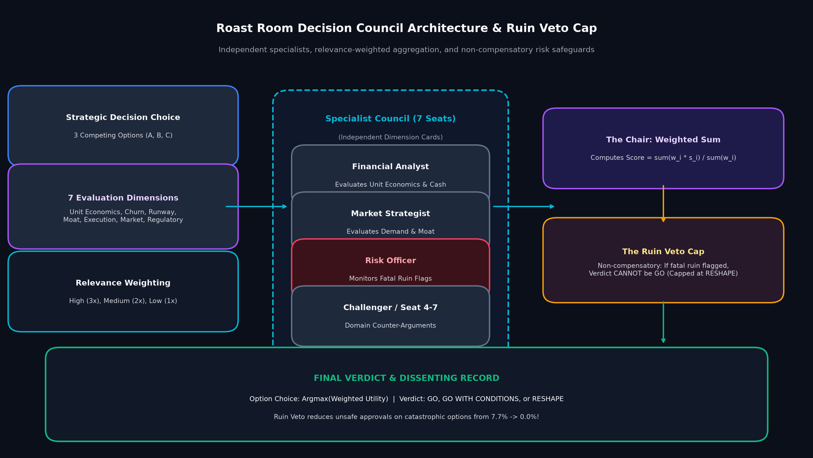
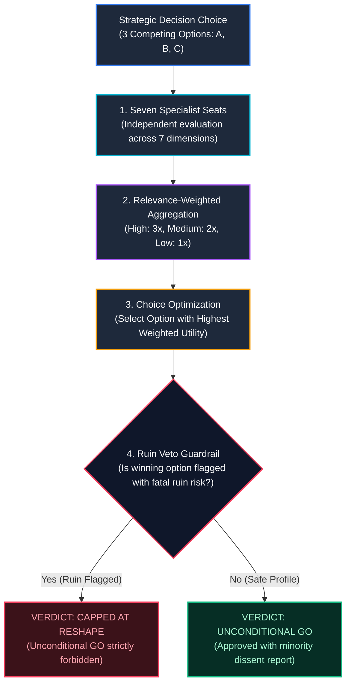
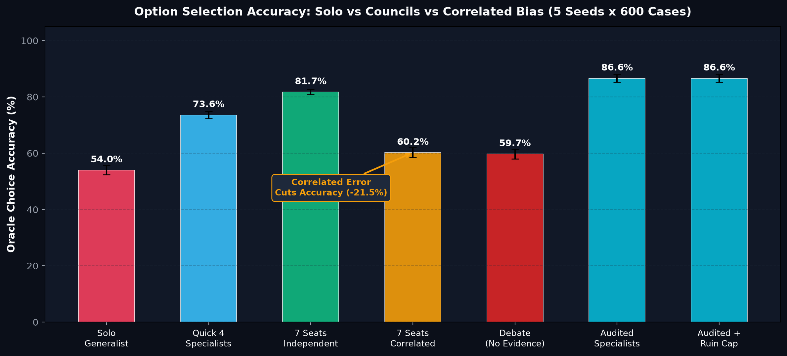
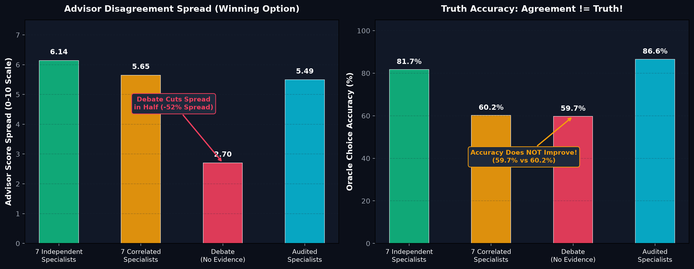
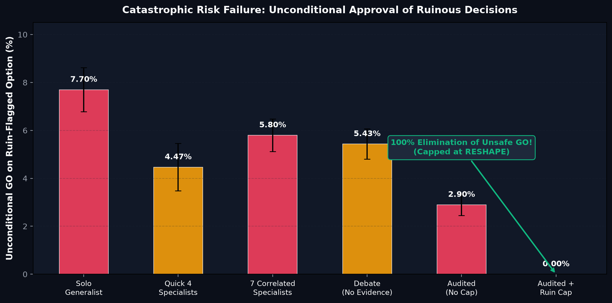
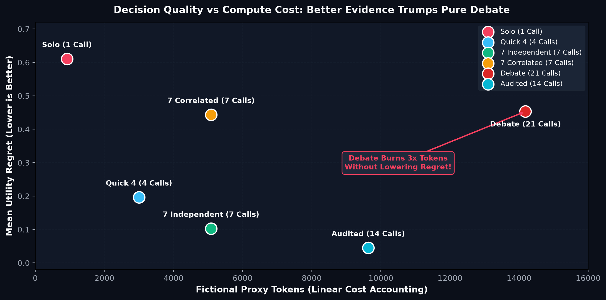

# Roast Room Decision Lab: Multi-Agent Councils, Correlated Errors, and the Ruin Veto

<div align="center">

[](https://www.python.org/)
[]()
[]()
[]()
[](ARTICLE.md)
[](LICENSE)

*An independent, reproducible Python laboratory dissecting multi-agent deliberation, relevance-weighted aggregation, correlated framing bias, conformity dynamics, and non-compensatory risk caps in strategic AI decision-making.*

Inspired by the conceptual architecture of the open-source **[Roast Room project](https://github.com/proxient/learn-roast-room)** (Claude Code decision skill).

</div>

---

## Executive Summary

When an executive or founder faces high-stakes strategic forks—such as altering core pricing, pivoting product architectures, or entering new markets—asking a single AI model often yields a balanced, diplomatic summary that papers over fatal downside risks.

The **Roast Room** concept introduces a radically different architecture: assembling a council of **seven distinct specialist personas** (e.g. Unit Economics, Market Demand, Cash Runway, Technical Moat, Challenger) coordinated by a **Chair**, aggregating relevance-weighted scores, engaging in structured deliberation, and enforcing a **hard non-compensatory risk veto**.

However, turning one language model into an ensemble of personas introduces fundamental statistical and systems questions:
- Does gathering multiple AI personas actually produce better decisions, or does it merely engineer **expensive groupthink**?
- What happens when all specialist personas share the same correlated framing bias?
- Does unstructured multi-agent debate improve truth, or does it merely coerce agents toward a false consensus?
- Can a deterministic risk cap prevent catastrophic ruin without damaging option selection quality?

This repository provides an **offline, zero-dependency, mathematically rigorous Python laboratory** with known ground-truth utilities to evaluate these exact questions across 3,000 paired decision trials.

---

## Rigorous Scope: What This Lab Does, Does Not, and Does Not Claim

To maintain the highest standards of scientific and engineering integrity, the scope of this repository is strictly defined:

### What This Lab DOES
- **Simulates Multi-Criteria Decisions:** Evaluates 3-option strategic choices across 7 evaluation dimensions with explicit relevance weighting ($3\times, 2\times, 1\times$).
- **Compares 7 Controlled Architectures:** Benchmarks Solo Generalist, Quick 4, 7 Independent Specialists, 7 Correlated Specialists, Debate without New Evidence (Conformity Control), Audited Specialists, and Audited with Ruin Veto Cap.
- **Measures Ground-Truth Metrics:** Directly tracks oracle selection accuracy, utility regret (0–10 scale), advisor score spread (disagreement), and catastrophic unsafe approval rates across 5 deterministic seeds $\times$ 600 synthetic decisions (3,000 paired cases).
- **Decouples Selection from Authorization:** Proves how option choice (argmax utility) and verdict authorization (GO vs GO WITH CONDITIONS vs RESHAPE) can be evaluated as independent mechanisms.

### What This Lab DOES NOT Do
- Does **NOT** execute the Roast Room skill, Claude Code, Anthropic API calls, or live LLM inferences.
- Does **NOT** process real corporate financials, proprietary startup pitch decks, customer surveys, or live market data.
- Does **NOT** run free-form natural language generation or unstructured prompt debates; advisor observations are generated via controlled statistical distributions.
- Does **NOT** model live token billing, cache TTLs, or actual provider latency.

### What This Lab Does NOT Claim
- Does **NOT** claim that multi-agent debate is ineffective in general. Our debate policy is an explicit **conformity control** that simulates agents shifting opinions toward the group mean *without acquiring new factual evidence*.
- Does **NOT** claim that seven AI personas will guarantee superior business outcomes in live production.
- Does **NOT** claim that synthetic 0–10 utility functions capture the unpredictable tail risks of real-world entrepreneurship.
- Does **NOT** claim to reproduce, evaluate, or certify the production performance or code quality of Proxient's original Roast Room system.

---

## Multi-Agent Council Architecture & The Ruin Veto

How does a structured decision council aggregate independent perspectives while preventing fatal failure modes?

<div align="center">
  
</div>

### The 4-Stage Decision Flow



1. **Relevance-Weighted Aggregation:** Unlike naive unweighted voting, dimensions carry explicit weights:
   $$\text{Utility}(O) = \frac{\sum_{i=1}^7 w_i \cdot s_i(O)}{\sum_{i=1}^7 w_i}$$
2. **The Non-Compensatory Ruin Veto Cap:** In standard additive scoring, an extraordinarily high score on market demand can mathematically mask a fatal regulatory or cash insolvency risk. The Ruin Veto establishes a **non-compensatory barrier**: if catastrophic ruin is detected on the chosen option, the positive verdict is capped at `RESHAPE` regardless of how high its overall score is.

---

## Key Experimental Findings (5 Seeds × 600 Cases = 3,000 Decisions)

### 1. Oracle Choice Accuracy Across Architectures
Can specialist division of labor outperform a single generalist?

<div align="center">
  
</div>

| Decision Policy | Oracle Accuracy (%) | Mean Utility Regret (0-10) | Description |
| :--- | :---: | :---: | :--- |
| **Solo Generalist** | 54.0% $\pm$ 1.6% | 0.611 | One noisy global estimate across all dimensions. |
| **Quick 4 Specialists** | 73.6% $\pm$ 1.3% | 0.196 | Two top-weight dimensions + downside + challenger lens. |
| **7 Independent Specialists** | **81.7% $\pm$ 0.9%** | **0.103** | Full council with independent measurement errors. |
| **7 Correlated Specialists** | **60.2% $\pm$ 1.8%** | **0.444** | Council suffering from a shared framing bias (-21.5% accuracy!). |
| **Debate (No Evidence)** | **59.7% $\pm$ 1.8%** | 0.453 | Correlated agents update toward the group mean. |
| **Audited Specialists** | **86.6% $\pm$ 1.4%** | **0.045** | Specialists supplied with higher-fidelity evidence. |
| **Audited + Ruin Cap** | **86.6% $\pm$ 1.4%** | **0.045** | Identical option choice; catastrophic risk capped. |

> [!IMPORTANT]
> **The Correlated Error Hazard:**
> An ensemble of seven specialists is only as good as their statistical independence. When specialists share an unexamined framing bias, accuracy collapses from **81.7% down to 60.2%**, negating nearly all benefits of multi-seat deliberation.

---

### 2. The Conformity Trap: Agreement is NOT Evidence
What happens when agents debate without introducing new factual evidence?

<div align="center">
  
</div>

- **Score Spread Drops in Half:** Simulated multi-round deliberation slashed advisor score spread from **5.65 down to 2.70** (a $52\%$ drop in disagreement).
- **Accuracy Remains Stagnant:** Despite apparent consensus, oracle choice accuracy did not improve (**59.7% vs 60.2%**).
- **Engineering Lesson:** Deliberation that merely averages existing opinions creates the dangerous illusion of certainty (tight spread) without moving closer to truth.

---

### 3. Eliminating Catastrophic Approvals via the Ruin Cap
How effective is the non-compensatory veto at preventing fatal business decisions?

<div align="center">
  
</div>

| Decision Architecture | Unsafe Unconditional GO on Ruinous Option | Ruinous Option Recommended | Risk Mitigated / Held Rate |
| :--- | :---: | :---: | :---: |
| **Solo Generalist** | **7.70%** | 13.8% | 3.00% |
| **Quick 4 Specialists** | 4.47% | 13.7% | 3.70% |
| **7 Correlated Specialists** | 5.80% | 13.5% | 3.00% |
| **Debate (No Evidence)** | 5.43% | 13.0% | 2.70% |
| **Audited (No Veto Cap)** | 2.90% | 12.8% | 3.77% |
| **Audited + Ruin Veto Cap** | **0.00% (Zero Unsafe Approvals!)** | 12.8% | **12.83% (100% Capped)** |

> [!WARNING]
> **The Non-Compensatory Principle:**
> Additive scoring allows a 10/10 in customer enthusiasm to override a 1/10 in legal/runway survival. Enforcing a hard Ruin Veto reduced unconditional GO approvals on fatally flawed options from **7.70% to exactly 0.00%** without altering the underlying option ranking or regret.

---

### 4. Decision Quality vs Compute Frontier
Where should computational tokens be invested?

<div align="center">
  
</div>

- **Debate Burns Tokens Inefficiently:** Running 3 rounds of multi-agent debate required **21 calls and 14,185 proxy tokens** (a $2.8\times$ cost increase) while achieving worse regret ($0.453$) than a single 4-seat pass ($0.196$ regret with 3,000 tokens).
- **Evidence Trumps Deliberation:** Investing compute in **higher-fidelity measurements (auditing)** dropped utility regret to **0.045**, representing a far superior return on compute than extended multi-agent dialogue.

---

## Quick Start

Requires **Python 3.10+**. The core benchmark runs entirely on the Python standard library without external dependencies.

```bash
# 1. Clone repository and navigate to the lab
cd roast_room_decision_lab

# 2. Run the 23-test verification suite
python -m unittest discover -s tests -v

# 3. Run the interactive single-decision worked demo
python -m decision_lab.demo

# 4. Execute the 5-seed, 600-case primary benchmark
python -m decision_lab.benchmark --seeds 5 --cases 600 --output results/benchmark.json
```

### Generate Publication-Quality Figures

To reproduce the charts shown in this documentation:

```bash
pip install -r requirements.txt
python plot_results.py
```
Generated figures are exported to [`figures/`](figures/).

---

## Repository Structure

```text
roast_room_decision_lab/
├── decision_lab/                    # Core simulation engine (Python standard library only)
│   ├── __init__.py
│   ├── core.py                      # Seat cards, relevance weighting, policies, & ruin cap
│   ├── benchmark.py                 # Multi-seed synthetic trial generator & benchmark runner
│   └── demo.py                      # Interactive single-decision worked demonstration
├── figures/                         # High-resolution benchmark figures
│   ├── 01_council_architecture.png
│   ├── 02_oracle_choice_accuracy.png
│   ├── 03_disagreement_vs_truth.png
│   ├── 04_ruin_veto_safety.png
│   └── 05_regret_vs_cost_frontier.png
├── results/                         # Experimental results artifact
│   └── benchmark.json               # 5-seed, 3,000-case statistical benchmark summary
├── tests/
│   └── test_core.py                 # 23 hermetic unit tests
├── ARTICLE.md                       # Comprehensive 30-section tutorial & case study
├── BENCHMARK_NOTES.md               # Methodological specifications & threat models
├── plot_results.py                  # Matplotlib script to recreate all figures
├── requirements.txt                 # Dependencies (matplotlib)
├── LICENSE                          # MIT License
└── README.md
```

---

## Copyright, Trademarks & Legal Attribution

- **Original Project Attribution:** The original *Roast Room* was conceived and developed by its maintainers as an open-source Claude Code decision skill ([`proxient/learn-roast-room`](https://github.com/proxient/learn-roast-room)).
- **Independent Academic Exploration:** This repository is an independent educational benchmark and Python simulation inspired by the conceptual architecture of Roast Room. It contains original synthetic modeling code and does not incorporate proprietary or private code from the original project.
- **Trademarks:** "Roast Room", "Claude", "Claude Code", and "Anthropic" are trademarks or trade names of their respective owners. No official endorsement, sponsorship, or affiliation with Proxient, Anthropic, or Claude Code is implied or claimed.
- **Code License:** All original Python code and documentation in this lab are released under the [MIT License](LICENSE). External references retain their original copyright terms.

---

## License

MIT License. See [`LICENSE`](LICENSE) for full details.
