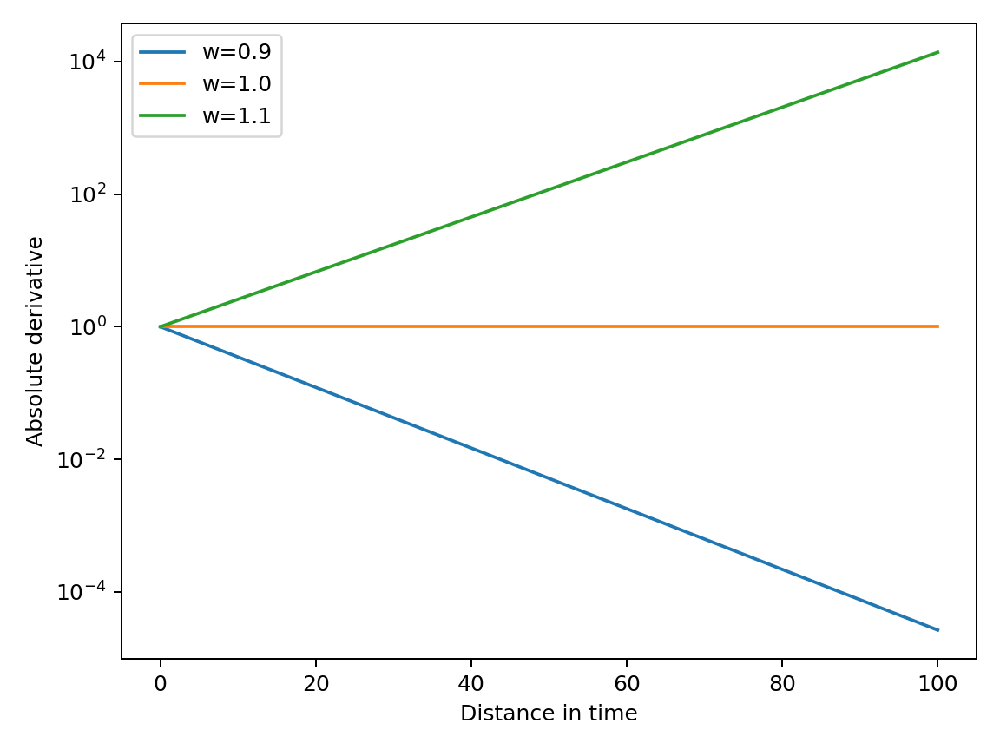
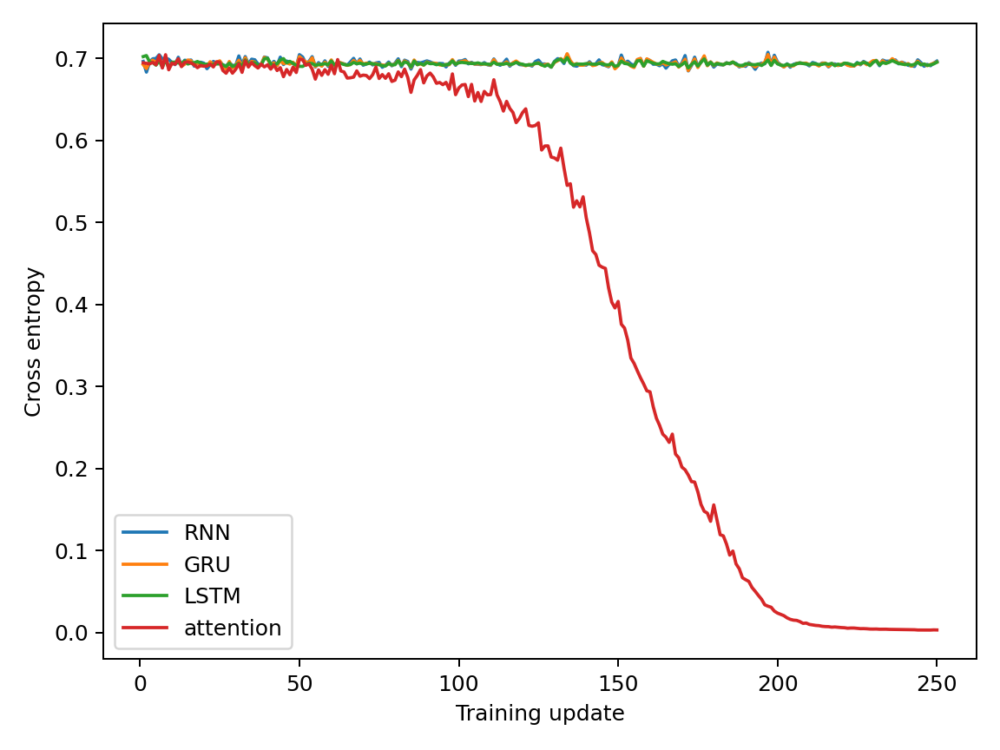
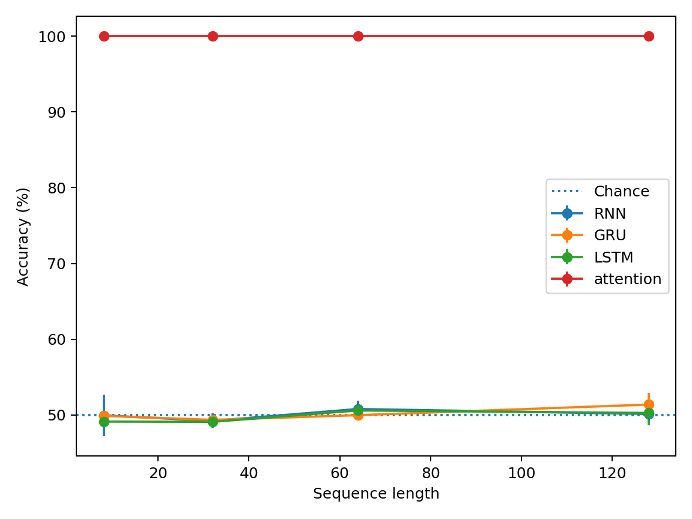

# Sequence Modeling: BPTT, Gating & Attention Extrapolation Lab

[](https://www.python.org/downloads/)
[](https://pytorch.org/)
[](#recorded-results)
[](#test-suite)
[](https://opensource.org/licenses/MIT)

A CPU-only reproducible research companion to Chapter 10 of *Deep Learning* (Goodfellow, Bengio, & Courville, 2016) and [`article.md`](./article.md). It verifies **manual Backpropagation Through Time (BPTT)** against PyTorch autograd to machine precision ($10^{-17}$), visualizes **exponential gradient decay/explosion** ($w^t$), and benchmarks **RNN, GRU, LSTM, and single-query dot-product attention** on a first-token recall task trained at $T = 32$ and evaluated from $T = 8$ to $T = 128$.

---

## Recorded Results (`results.json` & `run.log`)

- **Manual BPTT vs. PyTorch Autograd**: $\max|\Delta g_U| = 5.55 \times 10^{-17}$, $\max|\Delta g_W| = 4.16 \times 10^{-17}$.

### First-Token Recall Accuracy (3 Seeds, 250 Adam Steps at $T = 32$)

| Model | $T = 8$ | $T = 32$ *(train)* | $T = 64$ | $T = 128$ *(4× length)* |
|:---|---:|---:|---:|---:|
| `RNN` | `49.9%` | `49.2%` | `50.8%` | `50.1%` |
| `GRU` | `49.9%` | `49.3%` | `50.0%` | `51.4%` |
| `LSTM` | `49.1%` | `49.1%` | `50.6%` | `50.3%` |
| **`attention`** | **`100.0%`** | **`100.0%`** | **`100.0%`** | **`100.0%`** |

### Key Takeaway
Under a tight 250-step training budget on length-32 sequences, sequential recurrence (`RNN`, `GRU`, `LSTM`) remains at `~50%` chance because gradients must traverse $32$ recurrent steps, whereas direct content-based **attention** bridges the full path in $O(1)$ hops—achieving `100.0%` accuracy across all seeds and extrapolating cleanly to $T = 128$.

---

## Generated Visualizations (`figures/`)

| Exponential Gradient Scaling ($w^t$) | Training Loss Curves (250 Steps) | Length Extrapolation ($T = 8\text{--}128$) |
| :---: | :---: | :---: |
|  |  |  |

---

## Quickstart

### 1. Setup & Run

```bash
# Clone the repository
git clone https://github.com/AdityaInamdar334/Deep-Learning-Implementations.git
cd Deep-Learning-Implementations/sequence-lab

# Create virtual environment and install dependencies
python3 -m venv .venv
source .venv/bin/activate
pip install -r requirements.txt

# Run BPTT check + 12-run benchmark (writes figures/ and results.json)
python3 lab.py
```

### 2. Test Suite

```bash
python3 -m unittest discover -s tests -v
```

The 4 automated unit tests verify:
- **`test_manual_bptt_matches_autograd`**: Manual BPTT gradients match PyTorch autograd within $10^{-12}$.
- **`test_batch_contract`**: Exact `(N, T, 3)` inputs with start-of-sequence marker strictly at $t = 0$.
- **`test_memory_models_and_shapes`**: Valid `(B, 2)` logits for `RNN`, `GRU`, `LSTM`, and `attention`, with `attention` using fewer parameters than `RNN`.
- **`test_artifacts_present`**: Confirms `article.md`, `results.json`, `run.log`, and all 3 PNG figures exist.

---

## File Structure

```
sequence-lab/
├── README.md                  # Results table, figures, and quickstart
├── article.md                 # Full companion technical article
├── requirements.txt           # torch, numpy, matplotlib
├── .gitignore                 # Ignores __pycache__ and bytecode
├── lab.py                     # Manual BPTT check, MemoryModel, and 12-run benchmark
├── results.json               # BPTT errors, loss curves, and length accuracies
├── run.log                    # Recorded execution stdout
├── figures/                   # 3 generated PNG figures
└── tests/
    └── test_sequence.py       # 4 automated unit tests
```

---

## References

- Ian Goodfellow, Yoshua Bengio, & Aaron Courville (2016), *Deep Learning*, Chapter 10: Sequence Modeling: Recurrent and Recursive Nets. [deeplearningbook.org](https://www.deeplearningbook.org/contents/rnn.html)
- Sepp Hochreiter & Jürgen Schmidhuber (1997), *Long Short-Term Memory*, Neural Computation.
- Dzmitry Bahdanau, Kyunghyun Cho, & Yoshua Bengio (2015), *Neural Machine Translation by Jointly Learning to Align and Translate* (ICLR).
- Ashish Vaswani et al. (2017), *Attention Is All You Need* (NeurIPS).
