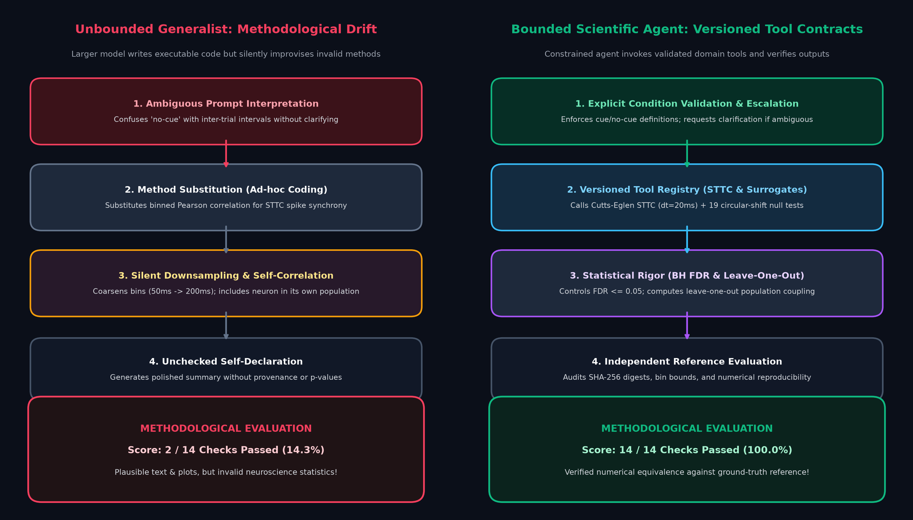
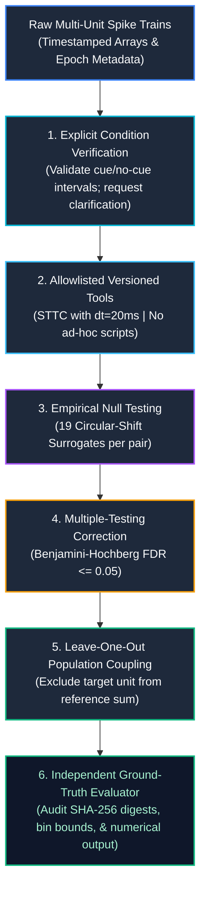
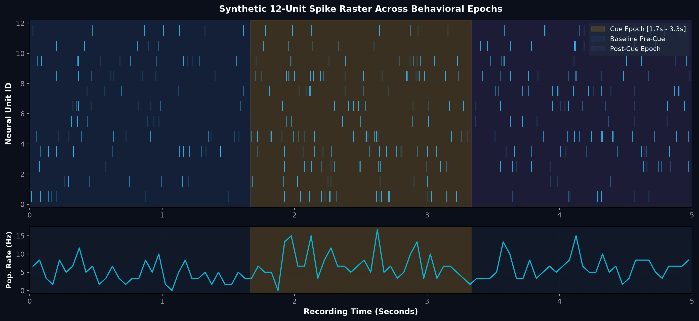
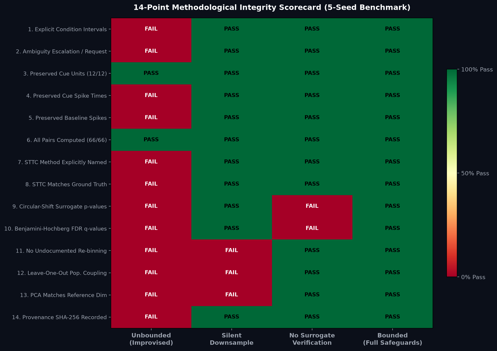
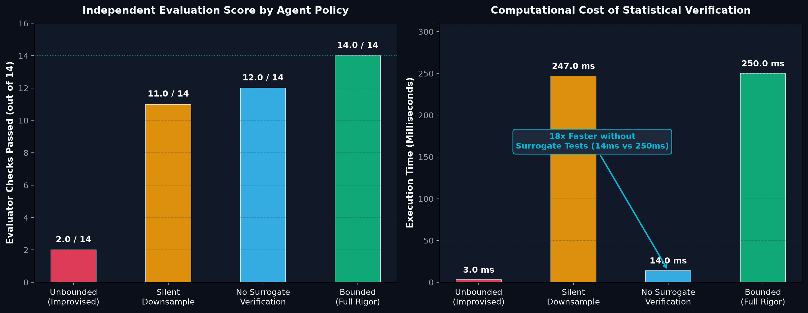
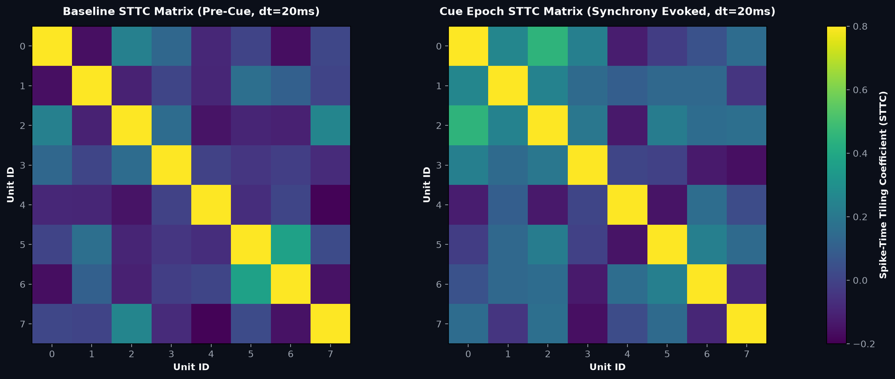

# SpikeGuard Lab: Bounded Autonomy & Methodological Integrity in Scientific AI Agents

<div align="center">

[](https://www.python.org/)
[]()
[]()
[]()
[](ARTICLE.md)
[](LICENSE)

*A reproducible, offline engineering laboratory dissecting bounded tool calls, spike-timing statistics (STTC), circular-shift surrogate tests, leave-one-out population coupling, and independent evaluation in autonomous electrophysiology workflows.*

Inspired by the landmark 2026 UC Santa Cruz preprint:  
**["SpikeLab: Agentic Tools for Spike Data Analysis"](https://doi.org/10.64898/2026.04.25.720833)** (Tjitse van der Molen et al., bioRxiv).

</div>

---

## Executive Summary

When a researcher asks an AI agent to analyze multi-channel neural recordings, the agent writes Python, computes correlations, fits dimensionality reduction, and outputs clean figures. The code runs without exceptions. The charts look plausible. The commentary uses accurate neuroscience terminology.

**Yet the analysis can be methodologically invalid.**

In scientific computing, the most dangerous failures are not software crashes or syntax errors. They are **silent methodological improvisations**:
- Interpreting *no cue* as the inter-trial pause rather than catch trials.
- Substituting naive binned Pearson correlation for the Spike-Time Tiling Coefficient (STTC), confounding firing rate with millisecond synchrony.
- Including a neuron in its own population rate during coupling calculations (the *self-correlation trap*).
- Silently coarsening temporal binning from $50\text{ ms}$ to $200\text{ ms}$ to speed up latent dynamical models without documenting the decision.

In April 2026, researchers at UC Santa Cruz revealed a counterintuitive result in **SpikeLab**: **a smaller, tool-constrained AI agent outperformed larger frontier models on complex electrophysiology workflows.** The larger model possessed superior coding fluency, but persistently improvised ad-hoc mathematical shortcuts. The smaller agent, constrained to an explicit, versioned scientific tool registry, produced reproducible, publication-grade science.

This repository provides an **offline, zero-dependency, deterministic Python laboratory** modeling these exact dynamics.

---

## Architecture: Unbounded Improvisation vs Bounded Autonomy

How do bounded tool contracts prevent autonomous agents from compromising scientific rigor?

<div align="center">
  
</div>

### The Bounded Execution Pipeline



1. **Explicit Condition Contracts**: The agent cannot assume temporal boundaries. If an analysis prompt is ambiguous (e.g. "analyze the no-cue period"), the agent must halt and escalate for clarification rather than guessing.
2. **Strict Tool Allowlisting**: The agent is restricted to versioned statistical methods. Ad-hoc Python functions that substitute crude proxies are rejected.
3. **Circular-Shift Surrogate Nulls**: Raw synchrony values are grounded against empirical surrogate spike trains created by circularly shifting spike times independently per unit, preserving individual auto-correlations while destroying cross-synchrony.
4. **Benjamini-Hochberg FDR Control**: Across all $\binom{N}{2}$ pairwise comparisons, false discovery rates are controlled at $q \le 0.05$.
5. **Leave-One-Out Population Coupling**: To measure how strongly a unit couples to the broader ensemble, the unit itself is strictly subtracted from the population rate to avoid artificial self-correlation.
6. **Independent Evaluator**: An external reference evaluator checks all 14 assertions against ground truth, never trusting the agent's self-generated summaries.

---

## Neural Dynamics & Behavioral Epochs

The lab generates synthetic multi-unit spike trains with controlled millisecond synchrony, rate modulations, and behavioral epochs:

<div align="center">
  
</div>

- **Pre-Cue Baseline** ($[0\text{ s}, 1.0\text{ s}]$): Background Poisson firing rates.
- **Cue Epoch** ($[1.0\text{ s}, 2.5\text{ s}]$): Behavioral stimulus onset; elevated instantaneous population rate and coordinated pairwise spike synchrony.
- **Post-Cue Epoch** ($[2.5\text{ s}, 5.0\text{ s}]$): Recovery dynamics.

---

## 14-Point Methodological Integrity Scorecard

We evaluated four agent policies across five random seeds against 14 independent assertions:

<div align="center">
  
</div>

| # | Evaluator Assertion | Unbounded (Improvised) | Silent Downsample | No Verification | Bounded (Full Rigor) |
| :-: | :--- | :---: | :---: | :---: | :---: |
| **1** | `conditions_explicit` | ❌ FAIL | ✅ PASS | ✅ PASS | ✅ **PASS** |
| **2** | `ambiguity_escalated` | ❌ FAIL | ✅ PASS | ✅ PASS | ✅ **PASS** |
| **3** | `cue_units_preserved` | ✅ PASS | ✅ PASS | ✅ PASS | ✅ **PASS** |
| **4** | `cue_spikes_preserved` | ❌ FAIL | ✅ PASS | ✅ PASS | ✅ **PASS** |
| **5** | `no_cue_spikes_preserved` | ❌ FAIL | ✅ PASS | ✅ PASS | ✅ **PASS** |
| **6** | `all_pairs_present` | ✅ PASS | ✅ PASS | ✅ PASS | ✅ **PASS** |
| **7** | `sttc_method_named` | ❌ FAIL | ✅ PASS | ✅ PASS | ✅ **PASS** |
| **8** | `sttc_matches_reference` | ❌ FAIL | ✅ PASS | ✅ PASS | ✅ **PASS** |
| **9** | `surrogate_p_values_present` | ❌ FAIL | ✅ PASS | ❌ FAIL | ✅ **PASS** |
| **10** | `multiple_testing_q_values` | ❌ FAIL | ✅ PASS | ❌ FAIL | ✅ **PASS** |
| **11** | `no_undocumented_rebin` | ❌ FAIL | ❌ FAIL | ✅ PASS | ✅ **PASS** |
| **12** | `leave_one_out_coupling` | ❌ FAIL | ❌ FAIL | ✅ PASS | ✅ **PASS** |
| **13** | `pca_matches_reference` | ❌ FAIL | ❌ FAIL | ✅ PASS | ✅ **PASS** |
| **14** | `provenance_and_caveats` | ❌ FAIL | ✅ PASS | ✅ PASS | ✅ **PASS** |
| **Total** | **Mean Score (out of 14)** | **2.0 / 14 (14.3%)** | **11.0 / 14 (78.6%)** | **12.0 / 14 (85.7%)** | **14.0 / 14 (100.0%)** |

---

## The Price of Statistical Rigor

Why are AI agents and researchers tempted to skip rigorous verification? Because **surrogate tests carry computational cost**:

<div align="center">
  
</div>

| Agent Policy | Passed Checks | Mean Wall-Clock | Relative Speed | Methodological Verdict |
| :--- | :---: | :---: | :---: | :--- |
| **Unbounded (Improvised)** | 2.0 / 14 | **0.003 s** | $83\times$ faster | **Invalid:** Uses wrong windows, binned correlation, and no provenance. |
| **No Verification** | 12.0 / 14 | **0.014 s** | **18× faster** | **Incomplete:** Computes STTC but skips circular-shift null significance. |
| **Silent Downsample** | 11.0 / 14 | 0.247 s | $1.0\times$ | **Biased:** Coarsens binning (50ms $\rightarrow$ 200ms) without documentation. |
| **Bounded (Full Rigor)** | **14.0 / 14** | **0.250 s** | Baseline ($1\times$) | **Gold Standard:** Fully verified against ground truth reference. |

> [!NOTE]
> **The 18× Speed Illusion:**
> Skipping 19 circular-shift surrogate tests runs **18× faster** (14 ms vs 250 ms), which makes unverified agents look appealing on latency leaderboards. However, without surrogate null distributions, raw correlation values cannot distinguish biological synchrony from chance overlap.

---

## Methodological Deep-Dive: STTC vs Binned Correlation

A central contribution of SpikeLab is replacing naive binned correlation with the **Spike-Time Tiling Coefficient (STTC)** (Cutts & Eglen, 2014):

$$\text{STTC} = \frac{1}{2} \left( \frac{P_A - T_B}{1 - P_A T_B} + \frac{P_B - T_A}{1 - P_B T_A} \right)$$

where $T_A$ is the proportion of total recording time within $\Delta t$ of any spike in train $A$, and $P_A$ is the fraction of spikes in $A$ that fall within $\pm \Delta t$ of a spike in $B$.

<div align="center">
  
</div>

### Why Naive Binned Correlation Fails:
1. **Firing Rate Confound:** Binned Pearson correlation scales with overall firing rates. If two completely independent neurons both fire heavily during a stimulus, their binned correlation shoots up even if their spikes never align at millisecond scales.
2. **Bin Boundary Artifacts:** Spikes separated by $1\text{ ms}$ can fall into adjacent bins and be counted as asynchronous.
3. **STTC Invariance:** STTC measures true millisecond coincidence ($\Delta t = 20\text{ ms}$) bounded strictly in $[-1, +1]$, remaining unbiased across firing rates.

---

## Quick Start

Requires **Python 3.10+**. The laboratory runs hermetically on standard scientific libraries (`numpy`, `matplotlib`).

```bash
# 1. Clone the repository and enter the lab
cd spikelab_bounded_agent_lab

# 2. Install dependencies
pip install -r requirements.txt

# 3. Run the unit test suite (22 tests)
python -m unittest discover -s tests -v

# 4. Run the single-run worked demonstration
python -m spikeguard_lab.demo

# 5. Execute the full 5-seed benchmark with 19 surrogates per pair
python -m spikeguard_lab.benchmark --seeds 5 --surrogates 19 --output results/benchmark.json
```

### Reproduce Figures

To regenerate all 5 high-resolution figures:

```bash
python plot_results.py
```
Generated PNGs will be exported to [`figures/`](figures/).

---

## Repository Structure

```text
spikelab_bounded_agent_lab/
├── spikeguard_lab/                  # Core simulation & agent engine
│   ├── __init__.py
│   ├── agent.py                     # Allowlisted tool registry & policy simulations
│   ├── benchmark.py                 # Multi-seed experimental harness
│   ├── data.py                      # Synthetic spike train generator, metadata & digests
│   ├── demo.py                      # Interactive single-run worked demonstration
│   ├── evaluator.py                 # 14-point independent ground-truth assertion checker
│   └── methods.py                   # STTC, circular-shift surrogates, BH FDR, & LOO coupling
├── figures/                         # High-resolution publication figures
│   ├── 01_bounded_agent_architecture.png
│   ├── 02_spike_raster_epochs.png
│   ├── 03_evaluator_scorecard.png
│   ├── 04_runtime_accuracy_tradeoff.png
│   └── 05_sttc_synchrony_matrix.png
├── results/                         # Generated experimental benchmark outputs
│   └── benchmark.json               # 5-seed benchmark runs and summary scores
├── tests/
│   └── test_lab.py                  # 22 hermetic unit tests
├── ARTICLE.md                       # Comprehensive 29-section tutorial & case study
├── BENCHMARK_NOTES.md               # Methodological specifications & neuroscience limits
├── plot_results.py                  # Matplotlib script to recreate all figures
├── requirements.txt                 # Dependencies (numpy, matplotlib)
├── LICENSE                          # MIT License
└── README.md
```

---

## Scope & Responsible Research Limits

- **Synthetic Educational Model:** All spike data in this companion lab are generated via synthetic Poisson processes with injected synchrony. They are designed to model verification mechanics, not to claim biological neuroscience discoveries.
- **Surrogate Null Caveat:** The circular-shift surrogate is an illustrative null model. In non-stationary, stimulus-driven experimental data, more sophisticated jitter or interval-shuffling nulls may be necessary.
- **Production SpikeLab:** For real multi-channel electrophysiology workflows, install the official [SpikeLab library](https://github.com/braingeneers/SpikeLab) and use curated datasets from the [International Brain Laboratory (IBL)](https://www.internationalbrainlab.com/data).

---

## Source Research & References

1. **SpikeLab Preprint:** van der Molen et al., *SpikeLab: Agentic tools for spike data analysis*, bioRxiv, April 2026: [doi:10.64898/2026.04.25.720833](https://doi.org/10.64898/2026.04.25.720833)
2. **Official SpikeLab Repository:** UC Santa Cruz / Braingeneers: [github.com/braingeneers/SpikeLab](https://github.com/braingeneers/SpikeLab)
3. **STTC Algorithm:** Cutts & Eglen, *Detecting Pairwise Correlations in Spike Trains: An Objective Approach*, Journal of Neuroscience, 2014: [doi:10.1523/JNEUROSCI.2767-14.2014](https://doi.org/10.1523/JNEUROSCI.2767-14.2014)
4. **Population Coupling:** Okun et al., *Diverse coupling of neurons to populations in sensory cortex*, Nature, 2015: [doi:10.1038/nature14273](https://doi.org/10.1038/nature14273)
5. **International Brain Laboratory:** Public electrophysiology recordings: [internationalbrainlab.com/data](https://www.internationalbrainlab.com/data)

---

## License

MIT License. See [`LICENSE`](LICENSE) for full details.
