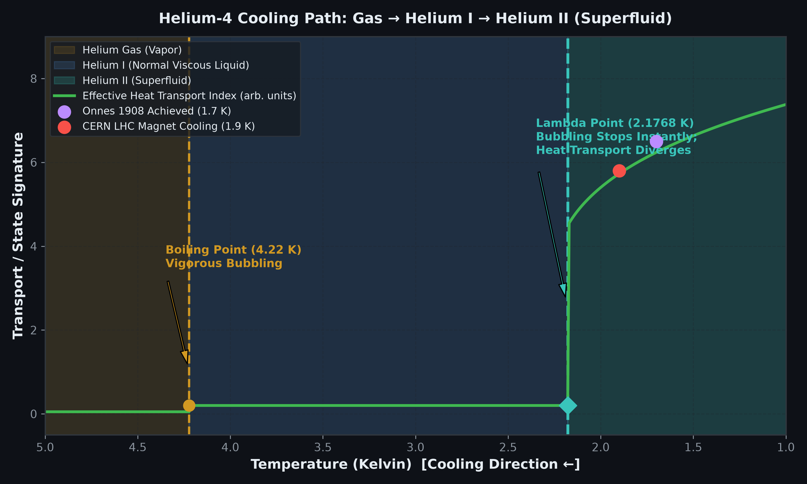
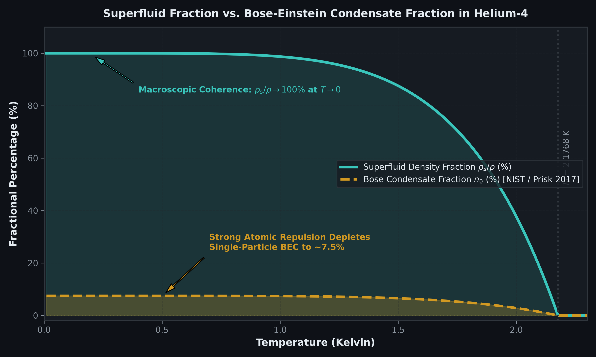
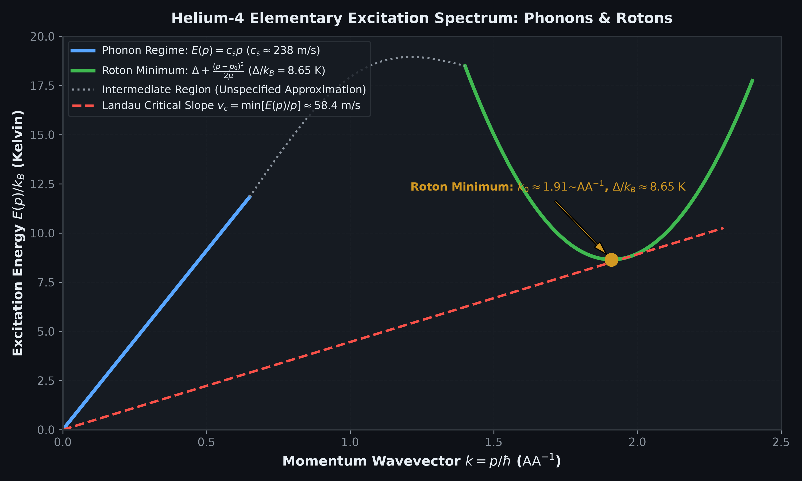
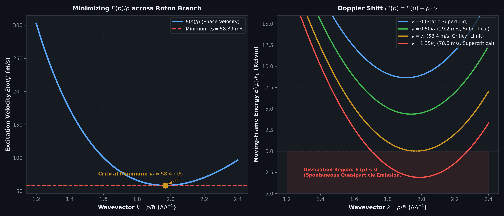

# Superfluid Helium Physics Lab: Quantum Phase Transitions, Two-Fluid Hydrodynamics & Landau Critical Velocity

**An offline, fully reproducible Python laboratory exploring the quantum physics, thermodynamics, and excitation spectrum of liquid Helium-4.**

[](LICENSE)
[](https://www.python.org/)
[](tests/test_superfluid.py)
[](#visual-gallery)

---

## Executive Summary

On July 10, 1908, Dutch physicist Heike Kamerlingh Onnes liquefied helium for the first time at Leiden University, cooling roughly sixty milliliters down to approximately 1.7 Kelvin. Three years later, on April 8, 1911—while discovering superconductivity in mercury—Onnes noted in his laboratory notebook that at approximately 2.2 Kelvin, liquid helium abruptly ceased its vigorous boiling, transforming into an eerily tranquil, calm liquid even while continuing to evaporate rapidly.

For the next 18 years, Onnes observed this liquid without recognizing that he was looking at **superfluidity**—a completely distinct, macroscopic quantum state of matter. The conceptual leap required almost thirty years, until Pyotr Kapitsa in Moscow and John F. Allen & A. Don Misener in Cambridge published back-to-back papers in *Nature* in January 1938 demonstrating near-zero capillary flow resistance.

This laboratory provides an end-to-end computational implementation of the core physics governing liquid Helium-4 ($^4\text{He}$):
1. **Thermodynamic Phase Transitions**: The gas-to-liquid boiling transition at $T_{\text{boil}} \approx 4.222\text{ K}$ and the second-order $\lambda$-transition at $T_\lambda = 2.1768\text{ K}$ into Helium II.
2. **The BEC vs. Superfluid Fraction Disconnect**: Resolving the prevalent misconception that superfluidity requires a 100% single-particle Bose-Einstein condensate. Due to strong hard-core repulsive interactions, the ground-state BEC fraction $n_0$ is depleted to only $\sim 7.5\%$ at low temperatures (Prisk et al., NIST 2017), even though the macroscopic superfluid density fraction $\rho_s / \rho \to 100\%$.
3. **Phonon-Roton Elementary Excitation Spectrum**: Acoustic phonons ($E = c_s p$, $c_s \approx 238\text{ m/s}$) and the roton minimum ($\Delta/k_B \approx 8.65\text{ K}$, $p_0/\hbar \approx 1.91 \text{ \AA}^{-1}$, $\mu \approx 0.16 m_{\text{He}}$).
4. **Landau Critical Velocity**: Minimizing $E(p)/p$ to deduce the frictionless flow ceiling $v_c \approx 58.4\text{ m/s}$ and Doppler-shifted energy dissipation $E'(p) = E(p) - p \cdot v$.
5. **Two-Fluid Counterflow & Second Sound**: Non-dispersive thermal entropy waves propagating at $c_2 \approx 20.46\text{ m/s}$ near $1.7\text{ K}$.
6. **Quantum Zero-Point Solidification Barrier**: Why liquid helium never freezes at ambient pressure, requiring $P \ge 25.3\text{ bar}$ to crystallize.

---

## Explicit Scope Disclosures

> [!IMPORTANT]
> **What this laboratory does:**
> - Implements literature-based analytical and empirical models for the thermodynamic and excitation properties of liquid Helium-4 at saturated vapor pressure.
> - Demonstrates Landau's quasiparticle excitation threshold ($v_c \approx 58.4\text{ m/s}$) and Doppler frame transformations.
> - Provides transparent, reproducible CLI utilities, automated unit tests (12/12 passing), and publication-quality dark-slate figures.
>
> **What this laboratory does NOT do:**
> - It does **not** simulate a microscopic many-body path-integral Monte Carlo (PIMC) lattice from first principles.
> - It does **not** fabricate an arbitrary fit for the intermediate "maxon" bridge between phonon and roton regimes where simple low-order approximations do not apply.
> - It does **not** simulate macroscopic quantum turbulence, quantized vortex tangle dynamics, or experimental fountain-pressure heads.
> - It does **not** claim to measure new experimental values; all parameters are calibrated against authoritative peer-reviewed experimental literature (NIST, Donnelly et al., Kapitsa, Landau, Cowley & Woods).

---

## Theoretical Foundations & Mathematical Formulations

### 1. Two-Fluid Hydrodynamics & Phase Boundaries

Liquid Helium-4 undergoes two distinct transitions upon cooling from room temperature:
- **Normal Boiling Point (1 atm)**: $T_{\text{boil}} = 4.222\text{ K}$. Latent heat of vaporization separates Helium Gas from Helium I.
- **Lambda Transition (SVP)**: $T_\lambda = 2.1768\text{ K}$. A continuous phase transition characterized by a logarithmic divergence in specific heat $C_p$, separating normal viscous Helium I from superfluid Helium II.

Under the Tisza-Landau two-fluid model, Helium II behaves as an interpenetrating mixture of two fluids:
$$\rho = \rho_n + \rho_s$$
where:
- $\rho_n$ is the normal fluid component, carrying all thermal entropy $S$ and possessing finite viscosity $\eta_n$.
- $\rho_s$ is the superfluid component, possessing zero entropy ($S = 0$), zero circulation curl ($\nabla \times \mathbf{v}_s = 0$), and zero viscosity in capillary transport.

The temperature dependence of the fractions satisfies:
$$\frac{\rho_n(T)}{\rho} \approx \left(\frac{T}{T_\lambda}\right)^{5.6}, \quad \frac{\rho_s(T)}{\rho} = 1 - \frac{\rho_n(T)}{\rho} \quad (T \le T_\lambda)$$

### 2. The Condensate Fraction ($n_0$) vs. Superfluid Density ($\rho_s/\rho$)

A widespread misconception equates superfluidity directly with pure non-interacting Bose-Einstein condensation ($n_0 \to 100\%$). In liquid $^4\text{He}$, strong short-range atomic repulsions cause severe quantum depletion:
- **Microscopic Ground State Occupancy**: Deep inelastic neutron scattering measurements (Prisk et al., NIST 2017) reveal that even at $T < 1.0\text{ K}$, the single-particle ground state occupancy is only:
  $$n_0 \approx 7.25\% \pm 0.75\% \approx 7.5\%$$
- **Macroscopic Superfluid Density**: Because macroscopic phase coherence extends over all particles via many-body correlations, the superfluid density fraction reaches:
  $$\lim_{T \to 0} \frac{\rho_s(T)}{\rho} = 1.0 \quad (100\%)$$

### 3. Elementary Excitation Spectrum: Phonons & Rotons

Landau demonstrated that Helium II is characterized by weakly interacting quasiparticles following an anomalous dispersion curve $E(p)$:
1. **Acoustic Phonon Branch** (low momentum, $k = p/\hbar \lesssim 0.6\text{ \AA}^{-1}$):
   $$E_{\text{phonon}}(p) = c_s p$$
   where $c_s \approx 238.3\text{ m/s}$ is the longitudinal speed of sound.
2. **Roton Minimum** (intermediate momentum, $k \approx 1.91\text{ \AA}^{-1}$):
   $$E_{\text{roton}}(p) = \Delta + \frac{(p - p_0)^2}{2\mu}$$
   where:
   - Roton energy gap: $\Delta / k_B \approx 8.65\text{ K}$ ($\Delta \approx 1.194 \times 10^{-22}\text{ J}$)
   - Roton wavevector: $k_0 = p_0 / \hbar \approx 1.91\text{ \AA}^{-1}$ ($p_0 \approx 2.014 \times 10^{-24}\text{ kg}\cdot\text{m/s}$)
   - Effective roton mass: $\mu \approx 0.16 m_{\text{He}} \approx 1.063 \times 10^{-27}\text{ kg}$

### 4. Landau Critical Velocity Criterion

Consider an object moving through Helium II at velocity $v$, or superfluid flowing through a capillary at speed $v$. In the reference frame of the moving fluid, creating an elementary excitation with momentum $p$ Doppler-shifts the energy to:
$$E'(p) = E(p) - \mathbf{p} \cdot \mathbf{v} = E(p) - p v \cos\theta$$

For dissipation to occur spontaneously, $E'(p) \le 0$, which requires:
$$v \ge \frac{E(p)}{p \cos\theta} \ge \min_p \left[ \frac{E(p)}{p} \right] \equiv v_c$$

Because the roton minimum creates a local dip in $E(p)$, the minimum slope occurs near $p_0$:
$$p^* = \sqrt{p_0^2 + 2\mu\Delta} \approx 1.031 p_0 \approx 2.076 \times 10^{-24}\text{ kg}\cdot\text{m/s}$$
$$v_c = \frac{E(p^*)}{p^*} \approx 58.39\text{ m/s} \approx 58.4\text{ m/s}$$

- For $v < v_c$, $E'(p) > 0$ for all states: quasiparticle creation is kinematically forbidden by energy-momentum conservation $\implies$ **completely dissipationless, frictionless flow**.
- For $v > v_c$, $E'(p) < 0$ at the roton branch: excitations can be created spontaneously, causing kinetic energy to dissipate into heat.

### 5. Second Sound & Thermal Wave Dynamics

Because Helium II possesses two interpenetrating fluid components that can move in counterflow ($\mathbf{j} = \rho_s \mathbf{v}_s + \rho_n \mathbf{v}_n = 0$), thermal perturbations propagate as non-dispersive temperature/entropy waves rather than classical thermal diffusion:
$$c_2 = \sqrt{\frac{\rho_s}{\rho_n} \frac{T S^2}{C_v}}$$
At $T \approx 1.70\text{ K}$, $c_2 \approx 20.46\text{ m/s}$. At $T \ge T_\lambda$, $c_2 = 0\text{ m/s}$.

### 6. Quantum Zero-Point Solidification Barrier

Helium atoms are light ($m_{\text{He}} \approx 6.65 \times 10^{-27}\text{ kg}$) and interact via extremely weak van der Waals dispersion forces. The quantum zero-point kinetic energy:
$$E_{\text{zp}} \approx \frac{\hbar^2}{2 m_{\text{He}} d^2}$$
exceeds the shallow interatomic potential well depth ($\sim 10.2\text{ K}$). Consequently, liquid Helium-4 remains liquid down to absolute zero ($T \to 0\text{ K}$) unless an external pressure of at least:
$$P \ge 25.3\text{ bar} \quad (2.53\text{ MPa})$$
is applied to compress the atoms into a crystalline lattice.

---

## Visual Gallery

The laboratory generates four high-resolution (300 DPI) figures rendered in a publication-grade dark-slate palette (`#0e1117`):

### Figure 1: Phase Boundaries & Cooling Path

*Helium-4 cooling path from 5.0 K down to 1.0 K. Highlights the normal boiling point at 4.22 K (vigorous bubbling), the lambda point at 2.1768 K (instant cessation of boiling and divergence of heat transport), Kamerlingh Onnes's 1908 1.7 K achievement, and the CERN LHC 1.9 K operating point.*

### Figure 2: Superfluid Density vs. BEC Condensate Fraction

*Direct comparison between the macroscopic superfluid density fraction $\rho_s/\rho$ (approaching 100% as $T \to 0$) and the microscopic single-particle BEC ground-state fraction $n_0$ (depleted to ~7.5% below 1 K by strong atomic repulsive core interactions, per NIST / Prisk et al. 2017).*

### Figure 3: Phonon-Roton Elementary Excitation Spectrum

*Helium-4 quasiparticle dispersion relation $E(p)/k_B$ versus wavevector $k = p/\hbar$. Shows the linear acoustic phonon branch ($c_s \approx 238\text{ m/s}$), the local roton minimum ($\Delta/k_B = 8.65\text{ K}$ at $k_0 \approx 1.91\text{ \AA}^{-1}$), and the Landau tangent line illustrating the critical velocity slope $v_c \approx 58.4\text{ m/s}$. The intermediate maxon region is intentionally left uncommitted.*

### Figure 4: Landau Critical Velocity & Doppler Shift

*(Left) Minimization of phase velocity $E(p)/p$ displaying the critical minimum $v_c \approx 58.4\text{ m/s}$. (Right) Doppler-shifted moving-frame excitation energy $E'(p) = E(p) - p \cdot v$ at static, subcritical ($0.5 v_c$), critical ($v_c$), and supercritical ($1.35 v_c$) flow velocities.*

---

## Quickstart & CLI Usage

### 1. Environment Setup

```bash
# Navigate to the lab directory
cd superfluid_helium_lab

# Create and activate a clean virtual environment
python3 -m venv .venv
source .venv/bin/activate

# Install dependencies (pure standard library + numpy + matplotlib)
pip install -r requirements.txt
```

### 2. Run the Thermodynamic & Quantum State Analyzer

Evaluate Helium-4 properties at the CERN LHC magnet cooling temperature ($T = 1.90\text{ K}$):

```bash
PYTHONPATH=src python3 -m superfluid_lab.cli --temperature 1.9 --out results
```

**Sample Output:**
```
========================================================================
         SUPERFLUID HELIUM-4 QUANTUM HYDRODYNAMICS REPORT
========================================================================
Temperature:            1.9000 K
Pressure:               1.00 bar
Phase:                  Helium II (Superfluid)
Lambda Transition:      T_lambda = 2.1768 K
------------------------------------------------------------------------
Superfluid Fraction:    rho_s / rho = 53.31%
Normal Fluid Fraction:  rho_n / rho = 46.69%
Bose Condensate Frac:   n_0 = 4.00% (Prisk et al. 2017)
------------------------------------------------------------------------
Phonon Sound Speed:     c_s = 238.3 m/s
Roton Minimum Gap:      Delta / k_B = 8.65 K
Landau Critical Speed:  v_c = 58.39 m/s
Second Sound Speed:     c_2 = 12.93 m/s
------------------------------------------------------------------------
Can Solidify at P:      False (Requires >= 25.3 bar)
========================================================================
Report saved to: results/superfluid_report.json
```

### 3. Generate Publication Figures

```bash
PYTHONPATH=src python3 -m superfluid_lab.plot
```

### 4. Run the Automated Unit Test Suite

```bash
PYTHONPATH=src python3 -m unittest discover -s tests -v
```

All 12 unit tests execute in milliseconds with zero external dependencies.

---

## Repository Structure

```
superfluid_helium_lab/
├── ARTICLE.md                  # Complete long-form research essay and historical narrative
├── LICENSE                     # MIT License
├── README.md                   # This comprehensive technical guide and figure gallery
├── requirements.txt            # Minimal runtime dependencies (numpy, matplotlib)
├── .gitignore                  # Clean build ignores
├── figures/                    # 300 DPI publication dark-slate figures
│   ├── 01_phase_transitions_cooling.png
│   ├── 02_condensate_vs_superfluid_fraction.png
│   ├── 03_phonon_roton_dispersion.png
│   └── 04_landau_critical_velocity.png
├── notebooks/                  # Interactive exploration
│   └── superfluid_helium_exploration.ipynb
├── results/                    # Machine-readable JSON output
│   └── superfluid_report.json
├── src/                        # Core Python implementation package
│   └── superfluid_lab/
│       ├── __init__.py         # Package exports
│       ├── core.py             # Phase boundaries, fractions, zero-point pressure
│       ├── landau.py           # Phonon-roton spectrum, v_c minimization, second sound
│       ├── plot.py             # Publication figure generators
│       └── cli.py              # Command-line driver and reporting engine
└── tests/                      # Automated test suite
    └── test_superfluid.py      # 12 verified physical unit tests
```

---

## References & Academic Literature

1. **Dirk van Delft (2008)**. *Little Cup of Helium, Big Science*. Physics Today. [Link](https://physicstoday.aip.org/features/little-cup-of-helium-big-science)
2. **Dirk van Delft & Peter Kes (2010)**. *The Discovery of Superconductivity*. Physics Today. [Link](https://physicstoday.aip.org/features/the-discovery-of-superconductivity)
3. **P. Kapitza (1938)**. *Viscosity of Liquid Helium below the $\lambda$-Point*. Nature 141, 74. [DOI: 10.1038/141074a0](https://doi.org/10.1038/141074a0)
4. **J. F. Allen & A. D. Misener (1938)**. *Flow of Liquid Helium II*. Nature 141, 75. [DOI: 10.1038/141075a0](https://doi.org/10.1038/141075a0)
5. **László Tisza (1938)**. *Transport Phenomena in Helium II*. Nature 141, 913. [DOI: 10.1038/141913a0](https://doi.org/10.1038/141913a0)
6. **Lev Landau (1941)**. *Theory of the Superfluidity of Helium II*. Physical Review 60, 356. [DOI: 10.1103/PhysRev.60.356](https://doi.org/10.1103/PhysRev.60.356)
7. **Fritz London (1938)**. *The $\lambda$-Phenomenon of Liquid Helium and the Bose-Einstein Degeneracy*. Nature 141, 643. [DOI: 10.1038/141643a0](https://doi.org/10.1038/141643a0)
8. **Timothy Prisk et al. (2017)**. *The Momentum Distribution of Liquid Helium-4*. NIST / Phys. Rev. B. [Link](https://www.nist.gov/publications/momentum-distribution-liquid-4he)
9. **R. A. Cowley & A. D. B. Woods (1971)**. *Inelastic Scattering of Neutrons by Liquid Helium*. Canadian Journal of Physics 49(2), 177-200.
10. **Russell J. Donnelly & Carlo F. Barenghi (1998)**. *The Properties of Liquid Helium in Undersaturated and Saturated States*. J. Phys. Chem. Ref. Data 27, 1217.
11. **CERN Cryogenics (2024)**. *Cryogenics: Low Temperatures, High Performance*. [Link](https://home.cern/science/engineering/cryogenics-low-temperatures-high-performance/)
12. **Patrik Švančara et al. (2024)**. *Rotating Curved Spacetime Signatures from a Giant Quantum Vortex*. Nature 628, 735-740. [DOI: 10.1038/s41586-024-07176-8](https://doi.org/10.1038/s41586-024-07176-8)

---

## License

This lab is released under the open-source [MIT License](LICENSE).
