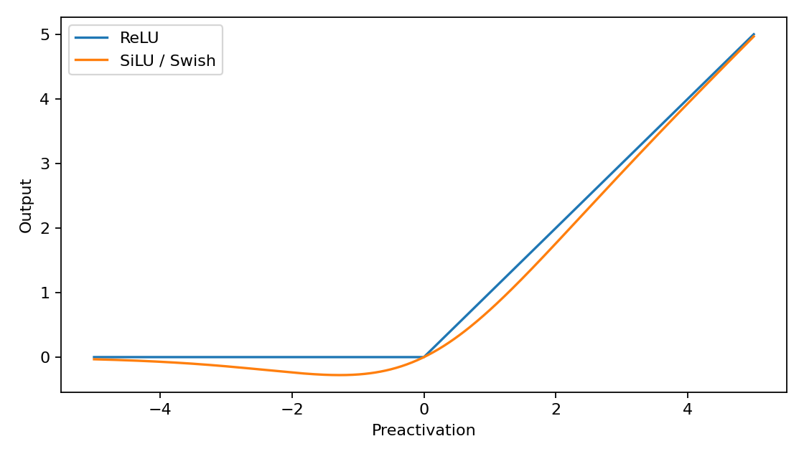
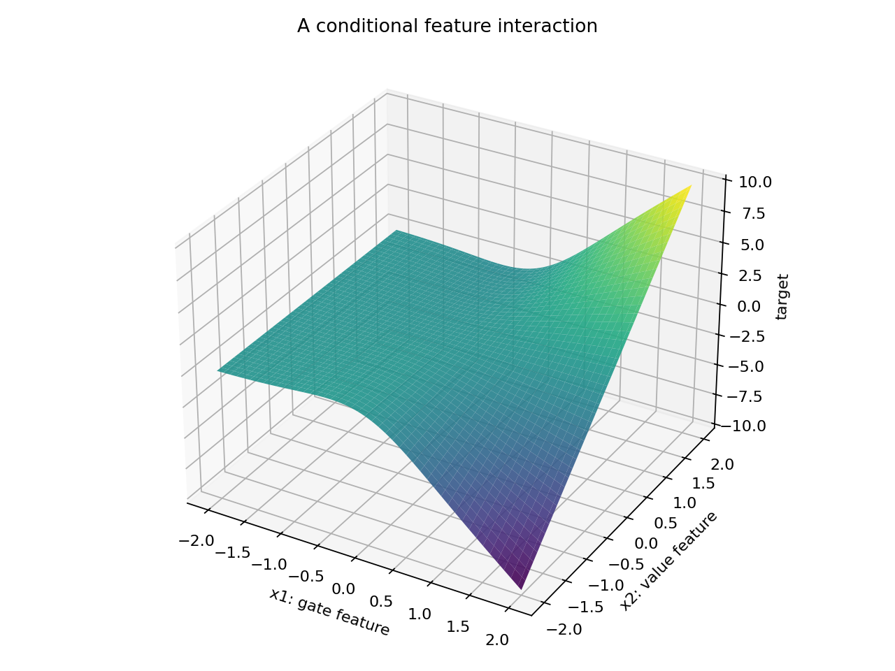
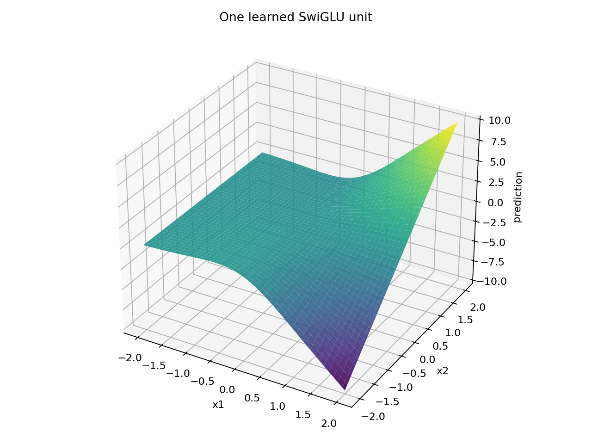

# SwiGLU From Scratch: Geometry & Parameter-Matched FFNs

[](https://www.python.org/downloads/)
[](https://pytorch.org/)
[](#parameter-matched-ffn-architecture)
[](#test-suite)
[](https://opensource.org/licenses/MIT)

A self-contained PyTorch lab exploring the geometric mechanics of **SwiGLU** (Swish-Gated Linear Units) from Noam Shazeer's *GLU Variants Improve Transformer* (2020): contrasting ReLU vs. SiLU activations, visualizing multiplicative gate-value interactions on a 2D surface, and verifying the exact $\frac{8}{3}d$ hidden-width rule that equalizes parameter counts between 2-matrix and 3-matrix Transformer FFNs.

> [!IMPORTANT]
> **Experimental Framing:** The synthetic regression task $y = \text{SiLU}(2.5 x_1) \cdot x_2$ is deliberately constructed to make multiplicative gating visible, and the 1-unit `ToySwiGLU` uses a favorable gate/value initialization to illustrate *representational structure* rather than claiming optimizer superiority. This lab does **not** train a full Transformer or reproduce Shazeer (2020) perplexity benchmarks.

---

## Parameter-Matched FFN Architecture

Standard Transformer FFNs use two projections with hidden width $4d$, while SwiGLU uses three projections (`gate_proj`, `up_proj`, `down_proj`). To keep the total parameter budget identical ($8d^2$ weights without biases), SwiGLU scales its hidden width to $\frac{8}{3}d$:

$$\text{PlainFFN}(x) = W_{\text{down}} \, \phi(W_{\text{up}} x) \implies 2 \cdot d \cdot (4d) = 8d^2$$
$$\text{SwiGLU}(x) = W_{\text{down}} \Big( \text{SiLU}(W_{\text{gate}} x) \odot (W_{\text{up}} x) \Big) \implies 3 \cdot d \cdot \left(\frac{8}{3}d\right) = 8d^2$$

```
  PLAIN FFN (2 Matrices, h = 4d)            SWIGLU FFN (3 Matrices, h = 8d/3)

               x (d)                                       x (d)
                 |                                      /         \
           [ up: d->4d ]                     [ gate: d->8d/3 ]  [ up: d->8d/3 ]
                 |                                    |                |
           ReLU / SiLU                              SiLU               |
                 |                                     \              /
          [ down: 4d->d ]                                ( Elementwise * )
                 |                                               |
               y (d)                                    [ down: 8d/3->d ]
                                                                 |
                                                               y (d)
```

*Note: Unlike a sigmoid gate bounded in $[0, 1]$, $\text{SiLU}(z) = z \cdot \sigma(z)$ is unbounded above and dips slightly negative near $z \approx -1.28$, allowing it to amplify or invert the value branch.*

---

## Generated Visualizations

| ReLU vs. SiLU Activation | Target Conditional Surface | Learned 1-Unit SwiGLU Surface |
| :---: | :---: | :---: |
|  |  |  |

---

## Quickstart

### 1. Setup & Run

```bash
# Clone the repository
git clone https://github.com/AdityaInamdar334/Deep-Learning-Implementations.git
cd Deep-Learning-Implementations/swiglu_from_scratch_lab

# Create virtual environment and install dependencies
python3 -m venv .venv
source .venv/bin/activate
pip install -r requirements.txt

# Run regression demo and regenerate figures
python3 swiglu_lab.py --plots
```

### 2. Test Suite

```bash
python3 -m pytest -q
```

The 4 automated tests verify:
- **`test_parameter_matching`**: Exact weight-count equality between `PlainFFN(96, 384)` and `SwiGLUFFN(96, 256)`.
- **`test_shapes`**: Exact 3D sequence tensor shape preservation `(2, 7, 96)`.
- **`test_exact_gate_representation`**: Exact analytical representation of `target(x)` by a single `ToySwiGLU` unit.
- **`test_silu_not_bounded`**: Confirms $\text{SiLU}(-1) < 0$, $\text{SiLU}(0) = 0$, and $\text{SiLU}(3) > 1$.

---

## File Structure

```
swiglu_from_scratch_lab/
├── README.md                               # Math derivations, diagrams, and figures
├── requirements.txt                        # torch, matplotlib, pytest
├── .gitignore                              # Ignores __pycache__ and .pytest_cache/
├── swiglu_lab.py                           # PlainFFN, SwiGLUFFN, toy models, and plotting
├── figures/
│   ├── relu_vs_silu.png                    # Activation curve comparison
│   ├── conditional_surface.png             # Ground-truth multiplicative interaction surface
│   └── learned_swiglu_surface.png          # Learned 1-unit SwiGLU surface
└── tests/
    └── test_lab.py                         # 4 automated pytest tests
```

---

## References

- Noam Shazeer (2020), *GLU Variants Improve Transformer*. [arXiv:2002.05202](https://arxiv.org/abs/2002.05202)
- Prajit Ramachandran, Barret Zoph, Quoc V. Le (2017), *Searching for Activation Functions*. [arXiv:1710.05941](https://arxiv.org/abs/1710.05941)
- Yann N. Dauphin et al. (2017), *Language Modeling with Gated Convolutional Networks* (ICML). [PMLR](https://proceedings.mlr.press/v70/dauphin17a.html)
- PyTorch Documentation: [`torch.nn.SiLU`](https://docs.pytorch.org/docs/stable/generated/torch.nn.SiLU.html)
