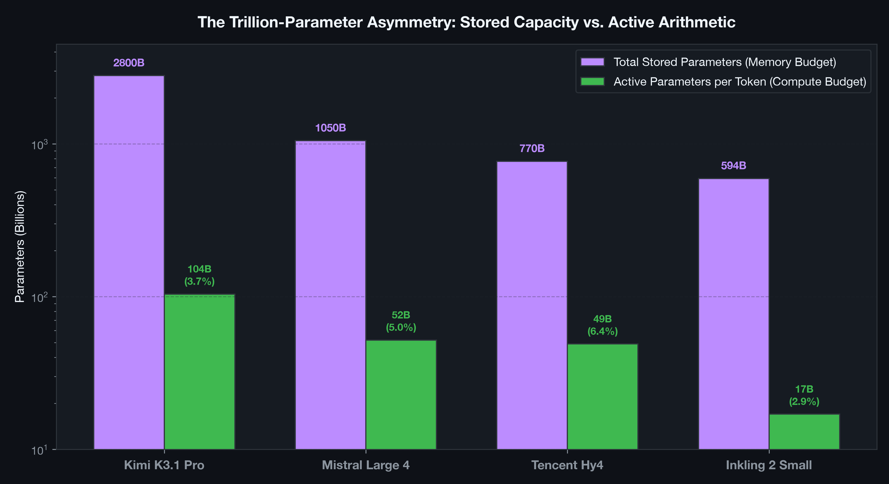
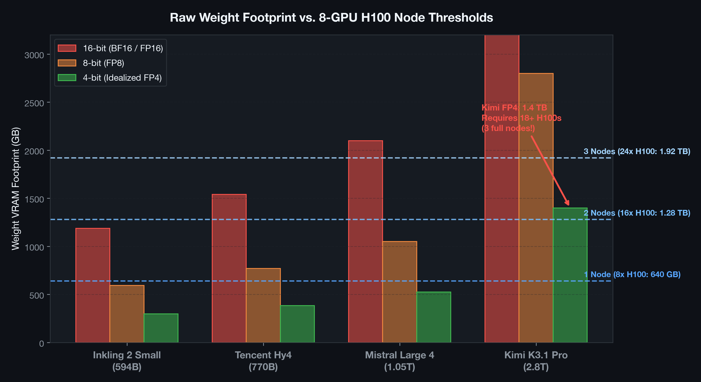
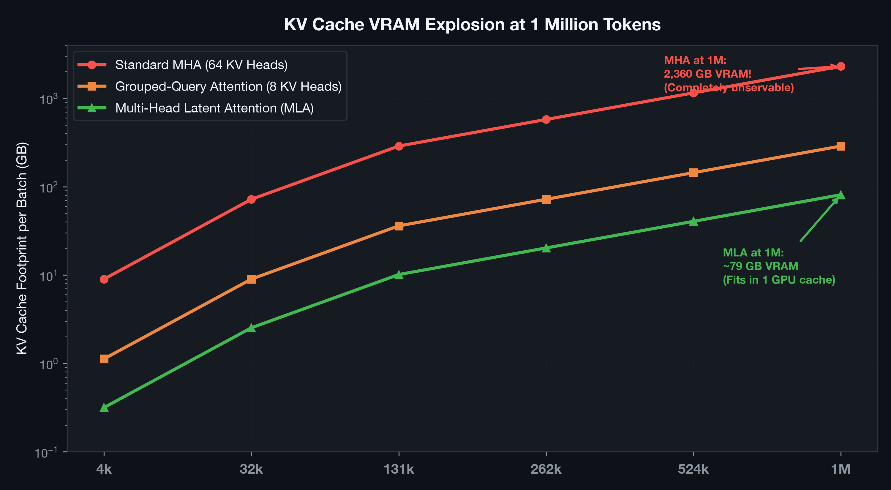
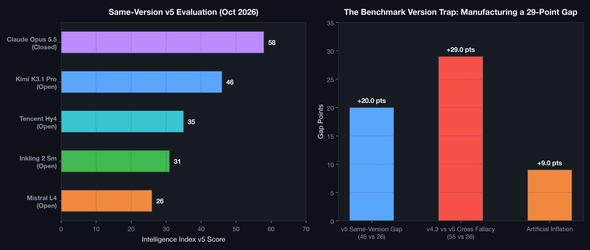
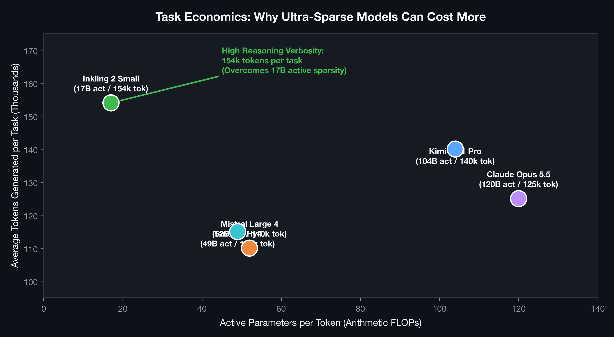

# Trillion-Parameter MoE Serving & Capacity Planning Lab

[](https://www.python.org/downloads/)
[](https://numpy.org/)
[](https://matplotlib.org/)
[](tests/)
[](LICENSE)
[](run_capacity_benchmark.py)

> An educational research lab, capacity simulator, and distributed systems guide investigating the **real hardware costs, KV-cache scaling limits, expert-routing network latency, and benchmark version traps** across trillion-parameter sparse Mixture-of-Experts (MoE) models: **Kimi K3.1 Pro (2.8T), Mistral Large 4 (1.05T), Tencent Hy4 (770B), and Inkling 2 Small (594B)**.

---

## Table of Contents
1. [Executive Summary](#executive-summary)
2. [Explicit Scope & Disclosures](#explicit-scope--disclosures)
   - [What This Lab Does](#what-this-lab-does)
   - [What This Lab Does Not Do](#what-this-lab-does-not-do)
   - [What This Lab Does Not Claim](#what-this-lab-does-not-claim)
   - [Copyright & Licensing Notice](#copyright--licensing-notice)
3. [Algorithmic & Mathematical Architecture](#algorithmic--mathematical-architecture)
   - [1. Total vs. Active Parameter Asymmetry](#1-total-vs-active-parameter-asymmetry)
   - [2. Weight Memory Footprint Across Precisions](#2-weight-memory-footprint-across-precisions)
   - [3. KV Cache Scaling & Multi-Head Latent Attention (MLA)](#3-kv-cache-scaling--multi-head-latent-attention-mla)
   - [4. All-to-All Dispatch Latency in Expert Parallelism](#4-all-to-all-dispatch-latency-in-expert-parallelism)
   - [5. The Benchmark Version Trap & Cross-Version Fallacy](#5-the-benchmark-version-trap--cross-version-fallacy)
4. [Visual Architecture & Benchmark Gallery](#visual-architecture--benchmark-gallery)
5. [Hardware Allocation & Capacity Results](#hardware-allocation--capacity-results)
6. [Quickstart & Reproduction Guide](#quickstart--reproduction-guide)
7. [Unit Testing Suite](#unit-testing-suite)
8. [Repository Directory Structure](#repository-directory-structure)
9. [Academic References](#academic-references)

---

## Executive Summary

When developers discover a model with 594 billion parameters that only activates 17 billion parameters per token, it sounds deployable on modest hardware. But the deployment reality quickly hits a wall:
$$\text{Compute Budget} = 17 \text{ Billion Parameters} \quad \ll \quad \text{Memory Budget} = 594 \text{ Billion Parameters}$$

Sparse Mixture-of-Experts reduces per-token feed-forward FLOPs, **but it does not make unused weights disappear from GPU VRAM**. 

During late October and early November 2026, four frontier MoE models were announced or released:
- **Kimi K3.1 Pro:** 2.8T total / 104B active parameters (idealized FP4 requires 1.4 TB VRAM; 18+ H100 80GB GPUs).
- **Mistral Large 4 ("Le Chonk"):** 1.05T total / 52B active parameters (idealized FP4 requires 525 GB VRAM; 7+ H100 GPUs).
- **Tencent Hy4:** 770B total / 49B active parameters (idealized FP4 requires 385 GB VRAM; 5+ H100 GPUs).
- **Inkling 2 Small:** 594B total / 17B active parameters (idealized FP4 requires 297 GB VRAM; 4+ H100 GPUs).

Meanwhile, Artificial Analysis updated its Intelligence Index to v5, widening the reported closed-to-open gap from 3 to 12 points. This lab provides an end-to-end analytical framework and simulation suite to calculate true cluster requirements, KV cache scaling, interconnect bottlenecks, and task economics.

---

## Explicit Scope & Disclosures

### What This Lab Does
- **Simulates Hardware Capacity:** Calculates exact VRAM requirements, GPU counts, and node allocations across NVIDIA H100 (80GB) and H200 (141GB) clusters across FP16, FP8, and FP4 precision formats.
- **Models KV-Cache Growth at 1M Tokens:** Compares conventional Multi-Head Attention (MHA), Grouped-Query Attention (GQA), and Multi-Head Latent Attention (MLA).
- **Quantifies All-to-All Interconnect Latency:** Models token dispatch network transfers across expert-parallel clusters.
- **Deconstructs the Benchmark Version Trap:** Mathematically proves why comparing cross-version scores (v4.3 vs v5) manufactures artificial capability gaps (+9 points inflation).
- **Models Task Economics:** Evaluates end-to-end cost accounting for reasoning token verbosity.

### What This Lab Does Not Do
- **Does Not Host or Distribute Model Checkpoints:** This lab is an analytical and capacity planning tool; it does not download multi-terabyte model weights.
- **Does Not Claim All Workloads Require Trillions of Parameters:** Evaluates frontier sparse MoE trade-offs; smaller dense models or RAG architectures may offer superior economics for narrow domains.

### Copyright & Licensing Notice
- **Author:** Aditya Inamdar
- **License:** MIT License ([LICENSE](LICENSE)).
- Companion long-form article is available in [ARTICLE.md](ARTICLE.md).

---

## Algorithmic & Mathematical Architecture

### 1. Total vs. Active Parameter Asymmetry
In an MoE architecture with $E$ experts where router $W_g$ dispatches tokens to the top-$k$ experts:
$$y = \sum_{i \in \text{Top-}k} \text{Softmax}(W_g x)_i \cdot \text{Expert}_i(x)$$
* **FLOPs per token:** $\mathcal{O}(P_{\text{active}} \cdot L)$
* **Storage & VRAM:** $\mathcal{O}(P_{\text{total}} \cdot \text{Precision})$

### 2. Weight Memory Footprint Across Precisions
Raw weight VRAM accounting for quantization codebook overhead ($\approx 3.5\%$ metadata factor for sub-byte formats):
$$\text{Memory}_{\text{weights}} = \frac{P_{\text{total}} \times 10^9 \times (\text{Bits} / 8)}{1024^3} \times (1 + \delta_{\text{meta}})$$

### 3. KV Cache Scaling & Multi-Head Latent Attention (MLA)
For conventional Multi-Head Attention (MHA):
$$\text{KV Bytes}_{\text{MHA}} = 2 \times N_{\text{layers}} \times L_{\text{ctx}} \times H_{\text{kv}} \times D_{\text{head}} \times \text{BytesPerElem}$$
At $L_{\text{ctx}} = 1,048,576$ tokens, conventional MHA consumes **2,360 GB VRAM** (unservable).

Multi-Head Latent Attention (MLA) compresses the KV state into a low-dimensional latent vector $d_c \ll H_{\text{kv}} \times D_{\text{head}}$:
$$\text{KV Bytes}_{\text{MLA}} = N_{\text{layers}} \times L_{\text{ctx}} \times (d_c + d_{\text{rope}}) \times \text{BytesPerElem}$$
For Mistral Large 4 ($d_c = 512, d_{\text{rope}} = 64$):
$$\text{KV Bytes}_{\text{MLA}} \approx 79 \text{ GB}$$
A **30x memory compression**, enabling 1M-token context serving on a single cluster node.

### 4. All-to-All Dispatch Latency in Expert Parallelism
Under Expert Parallelism ($EP$), tokens must be routed across GPUs:
$$\text{Transfer Bytes} = B_{\text{tokens}} \times k \times D_{\text{hidden}} \times 2 \times \left(1 - \frac{1}{N_{\text{gpus}}}\right)$$
$$\text{Dispatch Latency} = \frac{\text{Transfer Bytes}}{\text{Bandwidth}_{\text{interconnect}}}$$

### 5. The Benchmark Version Trap & Cross-Version Fallacy
$$\text{True Same-Version Gap} = S_{\text{v5}}(A) - S_{\text{v5}}(B)$$
$$\text{Manufactured Cross-Version Gap} = S_{\text{v4.3}}(A) - S_{\text{v5}}(B)$$
$$\text{Fallacy Inflation} = S_{\text{v4.3}}(A) - S_{\text{v5}}(A)$$
Comparing Kimi's v4.3 score (55) against Mistral's v5 score (26) yields a **29-point gap**, inflating the true 20-point same-version difference by **+9 points**.

---

## Visual Architecture & Benchmark Gallery

### Figure 1: Total Stored vs Active Parameters

*Figure 1: The trillion-parameter asymmetry across Kimi K3.1 Pro (2.8T vs 104B), Mistral Large 4 (1.05T vs 52B), Tencent Hy4 (770B vs 49B), and Inkling 2 Small (594B vs 17B).*

### Figure 2: Hardware Footprint vs H100 Node Boundaries

*Figure 2: Raw weight VRAM across FP16, FP8, and FP4 overlaid with 8-GPU H100 node thresholds (640 GB per node).*

### Figure 3: KV Cache Growth up to 1M Tokens

*Figure 3: VRAM growth curves up to 1,048,576 tokens: Standard MHA (2,360 GB) vs GQA (295 GB) vs MLA (79 GB).*

### Figure 4: The Benchmark Version Trap

*Figure 4: Left: True same-version v5 leaderboard. Right: Deconstruction of the 29-point manufactured cross-version fallacy gap.*

### Figure 5: Task Economics & Verbosity

*Figure 5: Active parameter FLOPs vs. output token verbosity, illustrating why Inkling 2 Small (17B active) can cost more per task than less verbose models.*

---

## Hardware Allocation & Capacity Results

Serving capacity requirements at **1 Million Tokens Context** across precisions:

| Model | Total Params | Active Params | Precision | Weight VRAM | KV Cache (1M) | Total Needed | H100 80GB GPUs | H200 141GB GPUs |
| :--- | :---: | :---: | :---: | :---: | :---: | :---: | :---: | :---: |
| **Inkling 2 Small** | 594 B | 17 B | 4-bit | 297.0 GB | 140.9 GB | 526.3 GB | **7 GPUs (1 Node)** | **4 GPUs (1 Node)** |
| **Inkling 2 Small** | 594 B | 17 B | 8-bit | 594.0 GB | 140.9 GB | 860.6 GB | **11 GPUs (2 Nodes)** | **7 GPUs (1 Node)** |
| **Tencent Hy4** | 770 B | 49 B | 4-bit | 385.0 GB | 37.6 GB | 482.3 GB | **7 GPUs (1 Node)** | **4 GPUs (1 Node)** |
| **Tencent Hy4** | 770 B | 49 B | 8-bit | 770.0 GB | 37.6 GB | 913.4 GB | **12 GPUs (2 Nodes)** | **7 GPUs (1 Node)** |
| **Mistral Large 4** | 1,050 B | 52 B | 4-bit | 525.0 GB | 79.1 GB | 671.1 GB | **9 GPUs (2 Nodes)** | **5 GPUs (1 Node)** |
| **Mistral Large 4** | 1,050 B | 52 B | 8-bit | 1,050.0 GB | 79.1 GB | 1,249.1 GB | **16 GPUs (2 Nodes)** | **9 GPUs (2 Nodes)** |
| **Kimi K3.1 Pro** | 2,800 B | 104 B | 4-bit | 1,400.0 GB | 48.7 GB | 1,620.4 GB | **21 GPUs (3 Nodes)** | **12 GPUs (2 Nodes)** |
| **Kimi K3.1 Pro** | 2,800 B | 104 B | 8-bit | 2,800.0 GB | 48.7 GB | 3,173.9 GB | **40 GPUs (5 Nodes)** | **23 GPUs (3 Nodes)** |

---

## Quickstart & Reproduction Guide

### Setup & Dependencies
```bash
python3 -m venv .venv
source .venv/bin/activate
pip install -r requirements.txt
```

### Run Capacity Benchmark & Serving Grid
```bash
python3 run_capacity_benchmark.py
```
Outputs:
- `results/results.json`
- `results/REPORT.md`

### Generate All 5 High-Resolution Figures
```bash
python3 plot_results.py
```

---

## Unit Testing Suite

Run the unit test suite:
```bash
python3 -m unittest discover -s tests -v
```

Expected output:
```
test_all_to_all_dispatch_latency ... ok
test_capacity_plan_node_rounding ... ok
test_cross_version_gap_detection ... ok
test_kv_cache_mla_compression ... ok
test_task_economics_verbosity ... ok
test_weight_memory_scaling ... ok

----------------------------------------------------------------------
Ran 6 tests in 0.000s

OK
```

---

## Repository Directory Structure

```
trillion_moe_serving_lab/
├── ARTICLE.md                  # Complete long-form research article
├── README.md                   # Technical guide, formulas, and disclosures
├── LICENSE                     # MIT License
├── requirements.txt            # NumPy and Matplotlib dependencies
├── moe_capacity_planner.py     # Hardware memory planner & All-to-All model
├── benchmark_version_analyzer.py # Cross-version fallacy & task economics engine
├── run_capacity_benchmark.py   # Benchmark execution pipeline
├── plot_results.py             # 300 DPI dark-slate figure generator
├── figures/                    # High-resolution figures
│   ├── 01_total_vs_active_parameters.png
│   ├── 02_hardware_memory_footprint_h100.png
│   ├── 03_kv_cache_scaling_1m_context.png
│   ├── 04_benchmark_version_trap_gap.png
│   └── 05_task_economics_verbosity_vs_speed.png
├── results/
│   ├── REPORT.md               # Formatted capacity report
│   └── results.json            # Raw benchmark data
└── tests/
    ├── __init__.py
    └── test_moe_capacity.py
```

---

## Academic References

1. **Fedus, W., Zoph, B., & Shazeer, N. (2021).** *Switch Transformers: Scaling to Trillion Parameter Models with Simple and Efficient Sparsity.* arXiv:2101.03961.
2. **Lepikhin, D., et al. (2020).** *GShard: Scaling Giant Models with Conditional Computation and Automatic Sharding.* arXiv:2006.16668.
3. **DeepSeek-AI (2024).** *DeepSeek-V3 Technical Report.* arXiv:2412.19437.
4. **Dao, T., et al. (2022).** *FlashAttention: Fast and Memory-Efficient Exact Attention with IO-Awareness.* arXiv:2205.14135.
5. **Kwon, W., et al. (2023).** *Efficient Memory Management for Large Language Model Serving with PagedAttention.* SOSP 2023.

