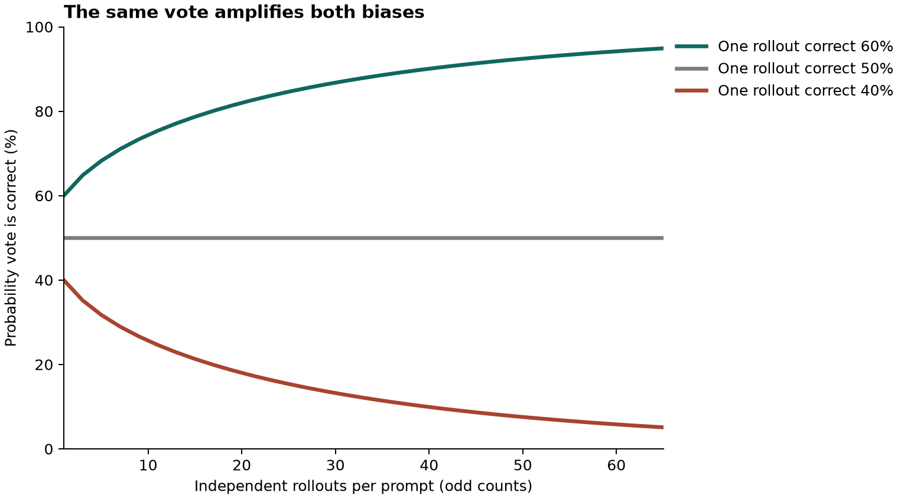

# When 65 AI Answers Are Worse Than One

*How test-time reinforcement learning turns agreement into a training signal, why a confident error can survive every vote, and what prompt-conditional DPO can actually fix.*

A model has a 60% chance of getting a particular binary question right. Ask it once and your chance of a correct answer is 60%. Ask it 65 times independently and take the majority. Your chance rises to **94.9%**.

Now give the same model a question on which it has a convincing misconception. Its chance of being right is 40%. The same 65-vote procedure drives your chance of getting the right answer down to **5.1%**.

Those are exact binomial probabilities in a deliberately simple experiment. The unsettling part is how similar the two situations look from inside the system. In both, one answer tends to win by a comfortable margin. Without an answer key, the vote tells you which answer the model favors. You still have to decide whether to teach that answer back to the model.

In *On the Reliability of Majority-Vote Pseudo-Labels in Test-Time Reinforcement Learning*, Haoyu Wang, Ru Wang, Yuanyuan Wang, Jiaxian Guo and Mingming Gong study that decision. Their November 2026 preprint proposes **PC-Dr.DPO**, a preference-training method that adjusts how much influence competing response pairs receive within a prompt. It also remembers earlier unanimous groups when later votes contradict them. One of the paper’s most informative results is a failure: on AIME 2025, a small Qwen model’s answers grew increasingly consistent while its evaluated accuracy collapsed to zero. [1, Appendix C.2]

## Contents

1. How a vote becomes a training label
2. The two ways a majority can be wrong
3. How PC-Dr.DPO changes an update
4. Why the algorithm remembers unanimous answers
5. What the 30 experiments show
6. Run the vote and gradient lab
7. What to measure before trusting self-supervision

## 1. How a vote becomes a training label

Imagine a model solving the same arithmetic problem eight times. Five completions end in 18, two end in 24 and one ends in 12. A self-consistency decoder could return 18 to the user and finish. Test-time reinforcement learning can take a further step: use 18 to decide which of those completions should become more likely on the next training update. [2, 3]

In an online Direct Preference Optimization (DPO) setup, the trainer might pair a completion ending in 18 with one ending in 24. It designates the first the winner and the second the loser. DPO scores how the policy’s relative preference for these two complete responses has changed from a reference policy. Training favors the designated winner. In this paper, the reference for an update is the behavior policy that generated its rollouts. [1, §§2, 4; 4]

There are three meanings of *correct* that are easy to blur here. A completion can match the selected answer. Its final answer can match the benchmark key. Its intermediate reasoning can be sound. Only the first of those properties is needed to construct a frequency-based pseudo-preference. A completion can guess 18 for a bad reason and still enter the winner pool. If 24 is the actual answer, a sound solution can enter the loser pool.

That distinction changes what a bad vote costs. With ordinary decoding, the user gets one wrong response. With online adaptation, the next policy samples from a distribution partly shaped by that response’s promotion. The evidence in round two has a history. It may look like a fresh confirmation while reflecting what the trainer rewarded in round one.

Earlier TTRL work demonstrated that this kind of self-generated reward can improve performance on some workloads. The question Wang and colleagues ask is which part of its unreliability can be addressed using the observations already available to the trainer. [1, 3]

## 2. The two ways a majority can be wrong

Freeze the model, the prompt and the sampling settings. Imagine being able to sample forever. The answer that occurs most frequently is the **population mode**. A real system gets a small batch of rollouts and observes a **sample mode**. For a question with many possible answers, the most frequent answer can have well under half the votes. The paper uses the term majority voting for this mode-selection operation. [1, §3]

The authors analyze a simpler setting where there are two possible answers, samples are independent conditional on the prompt and policy, and the vote has an odd number of members. Two errors then have different consequences.

**Finite-rollout variation** occurs when the sample picks a different winner from the population. If the model gives the correct answer 60% of the time, an unlucky set of nine samples can still favor the wrong one. More samples make that particular upset less likely.

**Population-majority bias** occurs when the population itself favors the wrong answer. Now a finite-sample upset is your only chance of getting the correct majority. More samples remove that chance, too.

That yields a compact reading of the paper’s error decomposition. Where the population winner is right, the vote is wrong exactly when sampling overturns it. Where the population winner is wrong, the vote is wrong exactly when sampling *fails* to overturn it. Keeping the behavior policy fixed, the vote concentrates toward its population winner more rapidly as the true answer probabilities move farther from a tie. This is the binary result. A model distributing votes across dozens of numeric answers requires reasoning about the gap between the leading alternatives. [1, Proposition 1 and Lemma 1]



*Figure 1. Exact probabilities for three synthetic binary prompts. The curves assume independent draws from a fixed policy. They illustrate the analysis and are separate from the authors’ empirical model results.*

Here is an identifiability problem you can work out without an equation. Suppose the trainer sees answer A on 70% of completions and answer B on 30%. Consider two possible answer keys, one marking A correct and one marking B correct. Every observable vote statistic has the same distribution in both worlds. Even an unlimited rollout budget cannot tell the trainer which key it is in. It needs additional information, such as an executable check, independent domain evidence, or a labeled evaluation set.

This is why the method uses the observed winning fraction as an indicator of **sampling sensitivity**. Eighteen votes out of 32 suggest a result that might change on a fresh draw. Twenty-eight out of 32 suggest a more stable result. Neither fraction measures the chance that the winning answer is true. A recurring misconception can easily produce the second pattern.

## 3. How PC-Dr.DPO changes an update

Start with one prompt and a group of winner–loser pairs. Some of the designated preferences may already agree with the direction in which the current policy has moved relative to its reference. Others may ask for a substantial reversal. Ordinary averaging gives each pair equal standing in the group objective. Distributionally robust DPO introduces a weighting that depends on the current pair scores. Wang and colleagues normalize that weighting **within each prompt**, preserving the prompt’s marginal weight, and let the vote determine the sharpness of the weighting. [1, §§2, 4; 5]

To see what the knobs control, keep three different temperatures separate.

- **Sampling temperature** changes how rollouts are drawn. The reported experiments used 0.8 with top-p 0.9.
- **DPO inverse temperature** scales the policy-versus-reference preference margin. The paper sets this parameter, called tau, to 0.1.
- **Robust temperature** controls the distribution of weights over preference pairs within one prompt. The paper multiplies a base value of 2 by the fraction of rollouts sharing the most frequent answer. This quantity stays fixed while differentiating the update. [1, §4 and Table 3]

A close vote gives a smaller robust temperature. That produces a **sharper** weighting. At first that sounds backwards. Why react to an uncertain label by concentrating more weight?

The answer is *which pairs receive it*. The weighting favors pairs with larger current DPO scores. Those are the pairs the objective already finds easier to satisfy, and their DPO residuals are smaller. The algorithm shifts influence toward them and away from harder pairs that would exert a larger corrective push under the questionable label.

Consider a synthetic group of three pairs with sigmoid-transformed preference scores of 0.9, 0.6 and 0.2. Hold those scores fixed. With 18 of 32 rollouts behind the modal answer, the easiest pair receives about **51.0%** of the weight and the hardest **13.4%**. With 28 of 32, the corresponding weights are **45.1%** and **19.1%**. The weighted residual increases from about **0.301** in the first case to **0.341** in the second. You can reproduce these numbers in the lab.

Two qualifications make this interpretation precise. First, the paper proves a statement about an **upper bound** on the prompt-gradient norm with pair scores held fixed. Actual parameter-gradient directions can reinforce or cancel one another. Second, this operation redistributes weight among pairs. Simply multiplying an entire prompt’s loss by its winning vote fraction implements a different algorithm. [1, Proposition 2]

There is a revealing boundary case. At the instant current and reference policies agree exactly, every policy-versus-reference margin is zero. All pair scores are equal, so every robust temperature gives the same uniform weights. The temperature distinction starts to matter once the pair scores diverge. The lab checks this case explicitly. It is an easy way to catch an implementation that accidentally applies the reliability factor to the whole prompt.

### Which answer supplies the winners?

The training method also changes how it selects an answer after the first step. When two successive policy snapshots are available, each rollout gets a score derived from the change in its sequence log likelihood between those snapshots. The algorithm sums these signed scores by extracted answer, then chooses the answer with the largest sum. The first step uses frequency because there is no lagged snapshot for that comparison. The modal fraction used for robust temperature remains a frequency statistic. [1, §4, Eq. 30–31 and 36]

Suppose A occurs three times with a score of 0.1 each, and B occurs twice with a score of 0.6 each. Frequency selects A. The summed trajectory scores select B, 1.2 to 0.3. A score records a change in model preference. A model can increase its preference for a wrong answer, so the new signal does not resolve the identifiability problem. It gives the algorithm another way to construct pairs from the available trajectories.

## 4. What happens when every rollout agrees?

If all 32 completions end in the same answer, there is no alternative answer from which to construct a loser. That prompt drops out of the fresh pairwise objective. Meanwhile, updates from other prompts continue to move shared model parameters. When the original prompt comes around again, its answer distribution may have changed.

The paper stores completions when a prompt first becomes unanimous. If a later sampled majority conflicts with the saved answer, the method discards the new pseudo-preference pairs for that prompt and trains the model to increase the likelihood of the saved completions. This replay term is combined with the normal group loss using its own coefficient. [1, §4, Eq. 34–35]

Think of a prompt whose saved answer is A. A week of other updates later, most samples say B. If A was correct, replay can preserve a useful behavior that is being forgotten. If A was wrong and B is an improvement, the same operation can protect an error. The cache records agreement at a moment in training. It has no independent answer key.

In the paper’s replay ablation on Llama-3.2-3B-Instruct with MATH500, removing the cache reduced final Avg@32 from **58.4% to 56.3%**, a **2.1 percentage-point** difference. That is evidence for the intervention in that particular run configuration. To decide whether it suits another domain, I would inspect how often the saved answer and the later answer are each correct when a replay triggers. The overall accuracy difference combines those two stories. [1, Appendix C.3]

## 5. Reading the headline against the actual table

The authors adapted five Qwen and Llama model configurations on six evaluations: AIME 2024, AIME 2025, AMC23, MATH500, GPQA-Diamond and the **mathematics subset** of MMLU-Pro. Adaptation used unlabeled prompts from the evaluation set or official test split. The score reports the final checkpoint after a benchmark-specific fixed budget. It describes adaptation on the target prompts. Transfer to a fresh set of unseen questions is a separate experiment. [1, §5]

The metric, **Avg@32**, is the mean correctness of 32 sampled responses. Imagine a prompt with 17 correct completions out of 32. Its contribution to Avg@32 is about 53.1%. In a binary setting, a single majority-vote answer for that same group would receive full credit. Distinguishing the training vote from the evaluation metric matters because a policy can change the frequency of its correct answers without changing which answer is most frequent. [1, §5]

The headline is that PC-Dr.DPO matches or exceeds the strongest TTRL baseline in **24 of 30** model–benchmark settings. I transcribed Table 1 and compared PC-Dr.DPO against the best displayed result among RENT, TTRL and Co-Reward in each cell. At the published precision, the breakdown is:

- **18 higher numeric scores**
- **4 numeric ties**
- **6 lower numeric scores**
- **2 settings where all four adaptation methods are marked as collapsed**

Counting the two shared collapses as matches yields 24. Restricting the comparison to the 28 settings with a numeric result yields **22 matches or improvements out of 28**. These are counts of displayed point estimates. They establish neither statistical significance for each win nor 24 successful adaptations. The supplied audit keeps a collapse distinct from a numerical zero. [1, Table 1]

There are substantial gains in some cells. On the MMLU-Pro math subset with Qwen2.5-3B-Instruct, the base model scored 53.6, the best comparison adaptation scored 46.4, and PC-Dr.DPO reached **64.7**. The base score is worth retaining here. A method can beat several adaptation baselines simply by avoiding their degradation. In this cell it also improved on the starting model. On AIME 2025 with Qwen2.5-7B-Instruct, however, ordinary TTRL scored **17.4** against **13.3** for PC-Dr.DPO. [1, Table 1]

The component tests tell a narrower story. On AMC with Qwen2.5-3B-Instruct, the full method scored **45.8**. The constant robust-temperature variant scored **42.0**, and the frequency-vote variant scored **44.6**. On MATH500 with that same backbone, the corresponding figures were **73.3**, **72.3** and **71.4**. The two interventions have different apparent contributions on the two tasks. Those ablations do not identify a universal best temperature or establish that trajectory scoring helps on every backbone. [1, Table 2]

Training used eight H100 GPUs on one node. PC-Dr.DPO sampled 32 rollouts and constructed eight preference pairs per prompt. RENT sampled eight rollouts directly. Equalizing how many training examples reach an update does not equalize all generation costs. For a team with a fixed inference budget, final accuracy per rollout or per generated token is another comparison worth making. [1, §5 and Appendix B]

## 6. Run the vote and gradient lab

Extract the ZIP, enter `vote_lab`, and run the following with Python 3.10 or later. The main exercises use only the standard library.

```bash
python votes.py
python audit.py
python check.py
```

**First, change the model’s competence.** Open `majority_correct` in `votes.py`. It sums the probabilities of seeing each possible winning count under independent binary draws. Try 9, 33 and 65 rollouts with correctness probabilities 0.4 and 0.6. The sample sizes here are odd to avoid a tie convention, matching the paper’s binary analysis. Its actual training runs used 32. Then try 0.5. A larger rollout budget cannot move a fair coin away from 50% in expectation.

**Next, change the update.** The `pair_objective` function takes DPO log-ratio margins, computes stable log-sigmoid scores and returns the prompt loss, the tilted weights and the derivative with respect to each margin. Read the weights alongside the residuals. The largest weight alone does not tell you which pair produces the largest gradient contribution. Perturb a margin by a small positive and negative amount and compare the numerical slope with the returned derivative. The test suite performs this check for both vote fractions.

**Then break the interpretation.** Give the scoring function three distinct completions with the same final answer. There is no loser. Store a unanimous group, then introduce a later group whose majority disagrees. The example prints the replay decision and uses rollout identifiers as stand-ins for completion text. Change the answer key *in your own interpretation* while leaving both groups untouched. The replay decision stays the same. That is a practical demonstration of what self-supervision cannot observe.

**Finally, audit the benchmark.** The `table1.json` file contains the displayed scores, with null for collapse. Read `audit.txt` to find all six lower-scoring settings. Ask which decision you would make for a single target workload if only its row mattered. An aggregate count is a useful summary of breadth, but the row for your model and domain determines which comparison deserves a replication budget.

The lab implements the binary calculation, the within-prompt loss and its derivatives, answer selection, and a simplified cache trigger. The published benchmark values come from the paper. All local checks use fixed examples and run without loading an LLM.

## 7. What I would measure before trusting this training signal

For an engineering trial, I would keep a small, independently labeled **audit set**, separate from the unlabeled examples used for adaptation. At each checkpoint I would record the following measurements for those prompts.

**Does agreement track correctness in this domain?** Bin prompts by winning fraction. Within each bin, measure the fraction of modal answers that are actually right. Look closely at the high-agreement errors. Increasing sampling budget is least likely to fix the cases that confidently converge to the wrong answer.

**Which mistakes come from answer extraction?** Different spellings of the same quantity can split the correct vote. An overly permissive parser can merge two quantities with different units. Save the raw responses as well as the normalized answers so that each apparent disagreement can be traced back to the extractor.

**What is being preserved by replay?** On prompts that trigger the cache, compare the earlier and later answers against the independent label. A count of replay events tells you how often the mechanism fired. You need the labels to measure how often it rescued a correct behavior or blocked a correction.

**Does any improvement transfer?** Hold out problem families before adaptation, keep paraphrases and near duplicates together, and compare checkpoints at equal generation budgets. Report run-to-run variation and collapsed runs. The original evaluation’s final-checkpoint convention is especially valuable when a training curve rises early and then falls apart.

The deepest failure in this paper is a quiet one. Training can make the model easier to predict while making its answers less useful. The next time a dashboard shows vote agreement rising, look for the second curve: how often an independently checked answer is right. The distance between those curves is exactly what the vote cannot tell you.

## References and companion materials

1. Haoyu Wang, Ru Wang, Yuanyuan Wang, Jiaxian Guo and Mingming Gong. *On the Reliability of Majority-Vote Pseudo-Labels in Test-Time Reinforcement Learning*. Version 1, November 6, 2026. Theory in §3, objective and replay in §4, numerical results in Tables 1–2, rollout settings and collapse analysis in Appendices B–C. [Full paper](https://arxiv.org/html/2611.09872v1) · [PDF](https://arxiv.org/pdf/2611.09872v1)
2. Xuezhi Wang and colleagues. *Self-Consistency Improves Chain of Thought Reasoning in Language Models*. [Paper](https://arxiv.org/abs/2203.11171)
3. Yuxin Zuo and colleagues. *TTRL: Test-Time Reinforcement Learning*. [Paper](https://arxiv.org/abs/2504.16084)
4. Rafael Rafailov and colleagues. *Direct Preference Optimization: Your Language Model Is Secretly a Reward Model*. [Paper](https://arxiv.org/abs/2305.18290)
5. Junkang Wu and colleagues. *Towards Robust Alignment of Language Models: Distributionally Robustifying Direct Preference Optimization*. [Paper](https://arxiv.org/abs/2407.07880)

*The companion contains a README, runnable Python, six checks, expected output, the table audit and an optional figure generator. The chart and the 65-vote example are exact calculations under stated assumptions.*
