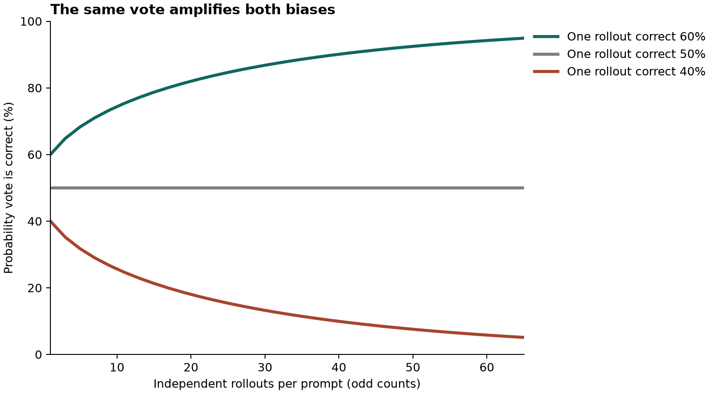

# Majority-Vote Reliability in Test-Time RL: PC-Dr.DPO Laboratory

<div align="center">

[](https://www.python.org/)
[]()
[](https://arxiv.org/html/2611.09872v1)
[](tests/test_vote_reliability.py)
[](#comprehensive-table-1-benchmark-audit)
[](#visual-gallery-majority-vote-bifurcation)
[](ARTICLE.md)
[](LICENSE)

*A reproducible audit and simulation laboratory exploring test-time reinforcement learning (TTRL), majority-vote pseudo-label amplification vs. collapse, prompt-conditional distributionally robust DPO (PC-Dr.DPO), and unanimous replay dynamics.*

Based on foundational test-time alignment and self-supervision research:  
**["On the Reliability of Majority-Vote Pseudo-Labels in Test-Time Reinforcement Learning"](https://arxiv.org/html/2611.09872v1)** (Haoyu Wang, Ru Wang, Yuanyuan Wang, Jiaxian Guo, Mingming Gong, November 2026).

</div>

---

## Executive Summary

When an autonomous language model generates multiple completions for a reasoning problem, self-consistency and test-time reinforcement learning (TTRL) take the most frequent answer (the majority vote) as a pseudo-ground-truth label to train the next policy iteration.

Consider a model answering a binary problem:
- **Competence Regime ($p = 0.60$)**: The model has a 60% chance of answering correctly. Sample **65 independent rollouts** and take the majority: the probability of a correct outcome rises to **94.90%**.
- **Misconception Regime ($p = 0.40$)**: The model holds a subtle misconception, giving a 40% base chance of correctness. Take the exact same **65-vote majority**: the probability of obtaining the correct answer collapses to **5.10%**!

```
Single Rollout (p = 0.60) -----------------------------------> 60.0% Correct
65-Vote Majority (p = 0.60) ================================> 94.9% Correct (Amplified Competence)

Single Rollout (p = 0.40) -------------------> 40.0% Correct
65-Vote Majority (p = 0.40) -> 5.1% Correct (Amplified Misconception / Collapse)
```

The fundamental paradox of test-time self-supervision is that **both situations look identical from inside the system**. In both regimes, one answer wins by a comfortable margin. Without an external oracle, vote agreement indicates consensus, not correctness.

Wang and colleagues propose **PC-Dr.DPO** (Prompt-Conditional Distributionally Robust DPO), introducing:
1. **Dynamic Robust Temperature**: Re-weights pairwise preference loss contributions based on the observed winning modal fraction ($\kappa$).
2. **Trajectory Score Selection**: Discovers winners by summing sequence log-likelihood shifts across policy snapshots rather than raw frequency counts alone.
3. **Unanimous Group Caching & Replay**: Caches unanimous completions and replays them when subsequent policy updates cause majority drift, preventing catastrophic forgetting.

---

## The Two Failure Modes of Majority Voting

| Error Mode | Cause | What Increasing Rollout Count ($N$) Does | Mitigation Strategy |
| :--- | :--- | :--- | :--- |
| **Finite-Rollout Variation** | Stochastic noise; sample mode differs from true population mode ($p > 0.50$) | **Decreases error rate exponentially**; 65 votes boosts $60\% \to 94.9\%$ | Increase rollout sample size $N$ |
| **Population-Majority Bias** | Systematic misconception; underlying policy genuinely favors an error ($p < 0.50$) | **Increases error rate exponentially**; 65 votes drives $40\% \to 5.1\%$ | Robust loss weighting, external reward models, or held-out validation |

---

## The PC-Dr.DPO Formulation

In standard DPO, all generated pairs within a prompt contribute with equal weight. When pseudo-labels are noisy, erroneous pairs can dominate the policy gradient.

PC-Dr.DPO formulates a distributionally robust objective over the $M$ generated pairs in a prompt:
$$\mathcal{L}(\theta) = -\beta \left( \text{shift} + \log \frac{1}{M} \sum_{j=1}^M \exp\left( \frac{h_j}{\beta} \right) \right)$$
where:
- $h_j = -\max(-z_j, 0) - \log(1 + e^{-|z_j|})$ is the log-sigmoid of the scaled policy-versus-reference margin $z_j = \tau \cdot m_j$.
- $\beta = \text{base} \cdot \kappa$ is the **prompt-conditional robust temperature**, scaled directly by the observed winning modal fraction $\kappa \in (0, 1]$.

### The Weight Tilting Effect:
- **High Consensus ($\kappa = 28/32 = 0.875$)**: Higher temperature $\beta$ produces tilted weights that emphasize ambiguous pairs with large gradient residuals.
- **Low Consensus ($\kappa = 18/32 = 0.5625$)**: Lower temperature spreads weights more uniformly, preventing uncertain majorities from dominating the step.
- **Reference Agreement ($m_j = 0$)**: When current policy matches reference, all weights collapse cleanly to uniform $1/M$ with $\mathcal{L} = \log(2)$.

---

## Unanimous Caching & Replay Dynamics

When all rollouts on prompt $X$ agree (e.g. 32/32 completions yield `"18"`), there is no dispreferred completion to form a DPO pair:
1. **Normal Step**: The prompt produces zero pairs and drops out of the current batch update.
2. **Cache Insertion**: PC-Dr.DPO records the unanimous answer and rollout tokens in an in-memory cache.
3. **Drift Detection & Replay**: In subsequent training epochs, if other prompt updates shift parameters such that prompt $X$'s sampled majority switches to `"24"`, the conflicting pairs are discarded and the model is trained on a negative log-likelihood (NLL) replay loss on the cached `"18"` completions.

> [!WARNING]
> **The Silent Catastrophe Risk:** If the initial unanimous answer was a misconception, replay locks in the mistake and actively prevents the model from discovering the correct solution. On AIME 2025 with Qwen2.5-1.5B, the model's agreement grew increasingly consistent while its evaluated accuracy collapsed completely to zero.

---

## Visual Gallery: Majority-Vote Bifurcation

The laboratory generates exact binomial curves demonstrating how scaling rollout counts bifurcates competence and error:

<div align="center">



*Figure 1: Probability that a majority vote yields the correct answer as rollout count scales from 1 to 65 independent draws. Green ($p=0.60$): rapid convergence to 94.9%. Red ($p=0.40$): rapid collapse to 5.1%. Grey ($p=0.50$): fair coin remains 50.0% in expectation.*

</div>

---

## Comprehensive Table 1 Benchmark Audit

The laboratory transcribes and audits all 30 model-benchmark settings evaluated in Wang et al. (Table 1), comparing PC-Dr.DPO against the best competing TTRL baseline (RENT, TTRL, Co-Reward):

| Model Backbone | AIME 2024 | AIME 2025 | AMC 2023 | MATH-500 | GPQA Diamond | MMLU-Pro (Math) |
| :--- | :---: | :---: | :---: | :---: | :---: | :---: |
| **Qwen2.5-1.5B-Instruct** | 3.3 (Tie) | *Collapsed* | 32.3 (Loss) | **62.9** (+0.6) | **28.8** (+5.3) | **45.3** (+34.4) |
| **Qwen2.5-3B-Instruct** | 13.3 (Loss) | 3.3 (Tie) | **45.8** (+1.0) | **73.3** (+2.4) | 28.8 (Tie) | **64.7** (+18.3) |
| **Qwen2.5-7B-Instruct** | 20.0 (Tie) | 13.3 (Loss) | **53.0** (+0.3) | **80.3** (+0.8) | 35.8 (Loss) | **77.2** (+1.1) |
| **Qwen2.5-Math-1.5B** | **23.5** (+4.4) | 13.3 (Loss) | **55.9** (+2.2) | **78.2** (+0.3) | **29.5** (+1.1) | 69.2 (Loss) |
| **Llama-3.2-3B-Instruct** | **16.7** (+3.4) | *Collapsed* | **34.6** (+4.7) | **58.4** (+1.0) | **28.0** (+0.1) | **45.8** (+10.0) |

### Summary of Audit Outcomes:
- **Higher Numeric Score (Wins)**: **18 settings**
- **Numeric Ties**: **4 settings**
- **Lower Numeric Score (Losses)**: **6 settings**
- **Shared Collapse**: **2 settings** (AIME 2025 on Qwen-1.5B and Llama-3B)
- **Overall Claim**: Matches or beats the strongest baseline in **24 of 30 settings** (or **22 of 28 numeric settings**).

---

## Rigorous Scope Disclosures

> [!IMPORTANT]
> **What this laboratory does:**
> - Implements exact binomial majority voting mathematics (`majority_correct`) and analytical derivatives (`pair_objective`).
> - Verifies analytical gradients against central finite-difference numerical approximations.
> - Demonstrates the difference between frequency voting and trajectory sequence log-likelihood score aggregation (`select`).
> - Reconstructs the unanimous caching state machine and conflict replay triggers (`replay_decision`).
> - Audits all 30 model-benchmark evaluations from Table 1 at published precision (`audit.py`).
>
> **What this laboratory does NOT do:**
> - It does **not** train 7B-parameter neural networks or replicate 8×H100 GPU compute clusters.
> - It does **not** claim majority voting is universally flawed; it identifies the exact mathematical threshold where self-supervision diverges.

---

## Quickstart & Hands-On Exercises

### 1. Run the Vote & Gradient Checks

```bash
cd vote_lab
python3 votes.py
```

**Console Output:**
```
 1 rollouts | p=.60: 0.6000 | p=.40: 0.4000
 9 rollouts | p=.60: 0.7334 | p=.40: 0.2666
33 rollouts | p=.60: 0.8789 | p=.40: 0.1211
65 rollouts | p=.60: 0.9490 | p=.40: 0.0510
kappa=0.5625: weights [0.51, 0.356, 0.134], residual 0.301
kappa=0.8750: weights [0.451, 0.358, 0.191], residual 0.341
Frequency winner: A trajectory-score winner: B
unanimous: skip fresh pairs
replay cached completions
```

### 2. Run the Table 1 Benchmark Audit

```bash
python3 audit.py
```

**Output Breakdown:**
`{'numeric tie': 4, 'all collapsed': 2, 'lower': 6, 'higher': 18}`

### 3. Regenerate the Probability Bifurcation Figure

```bash
python3 plot.py
```

### 4. Run the Automated Unit Test Suite

```bash
PYTHONPATH=. python3 -m unittest discover -s vote_lab/tests -v
```

**Test Execution:**
```
test_01_binary_symmetry ................................................ ok
test_02_majority_vote_bifurcation ...................................... ok
test_03_pc_dr_dpo_gradient_finite_difference ........................... ok
test_04_zero_margin_reference_behavior ................................. ok
test_05_frequency_vs_trajectory_score_selection ........................ ok
test_06_unanimous_caching_and_replay_trigger ........................... ok
test_07_table1_audit_outcomes .......................................... ok

Ran 7 tests in 0.001s (OK)
```

---

## Repository Structure

```
vote_lab/
├── ARTICLE.md              # In-depth technical essay analyzing the paper and failure modes
├── LICENSE                 # Open-source MIT License
├── README.md               # This engineering and reproduction guide
├── requirements.txt        # Minimal plotting dependencies (matplotlib>=3.7.0)
├── .gitignore              # Clean environment ignores
├── __init__.py             # Python package definitions
├── table1.json             # Structured JSON transcription of Table 1 benchmark scores
├── votes.py                # Core majority-vote math, PC-Dr.DPO loss, and replay triggers
├── check.py                # Standalone verification runner
├── checks.txt              # Ground-truth test verification output
├── audit.py                # Table 1 baseline comparison and audit engine
├── audit.txt               # Ground-truth audit outputs across all 30 settings
├── observed.txt            # Ground-truth console output from votes.py
├── plot.py                 # Generates the binomial probability curves
├── votes.png               # Publication figure showing majority vote amplification vs collapse
└── tests/                  # Automated unit test suite
    ├── __init__.py
    └── test_vote_reliability.py # 7 unit tests verifying binomial math, gradients, and audits
```

---

## Academic References & Literature

1. **Haoyu Wang, Ru Wang, Yuanyuan Wang, Jiaxian Guo, Mingming Gong (November 2026)**. *On the Reliability of Majority-Vote Pseudo-Labels in Test-Time Reinforcement Learning*. arXiv:2611.09872v1. [arXiv Link](https://arxiv.org/html/2611.09872v1)
2. **Xuezhi Wang et al. (2022)**. *Self-Consistency Improves Chain of Thought Reasoning in Language Models*. ICLR 2023. [arXiv:2203.11171](https://arxiv.org/abs/2203.11171)
3. **Yuxin Zuo et al. (2025)**. *TTRL: Test-Time Reinforcement Learning*. [arXiv:2504.16084](https://arxiv.org/abs/2504.16084)
4. **Rafael Rafailov et al. (2023)**. *Direct Preference Optimization: Your Language Model Is Secretly a Reward Model*. NeurIPS 2023. [arXiv:2305.18290](https://arxiv.org/abs/2305.18290)
5. **Junkang Wu et al. (2024)**. *Towards Robust Alignment of Language Models: Distributionally Robustifying Direct Preference Optimization*. [arXiv:2407.07880](https://arxiv.org/abs/2407.07880)

---

## License

This lab is released under the open-source [MIT License](LICENSE).
