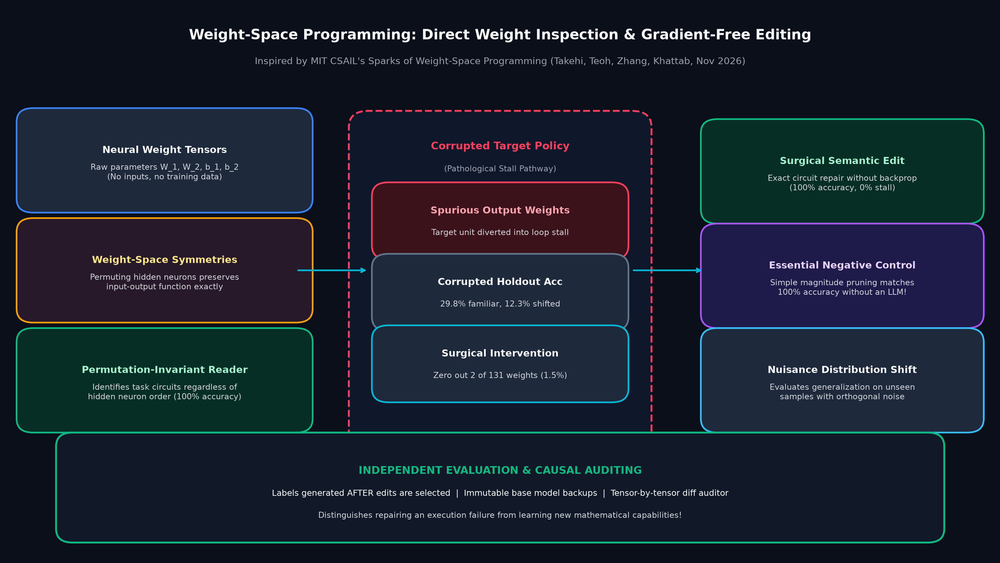
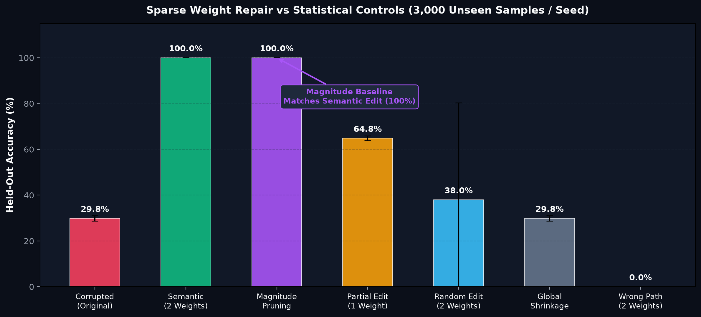
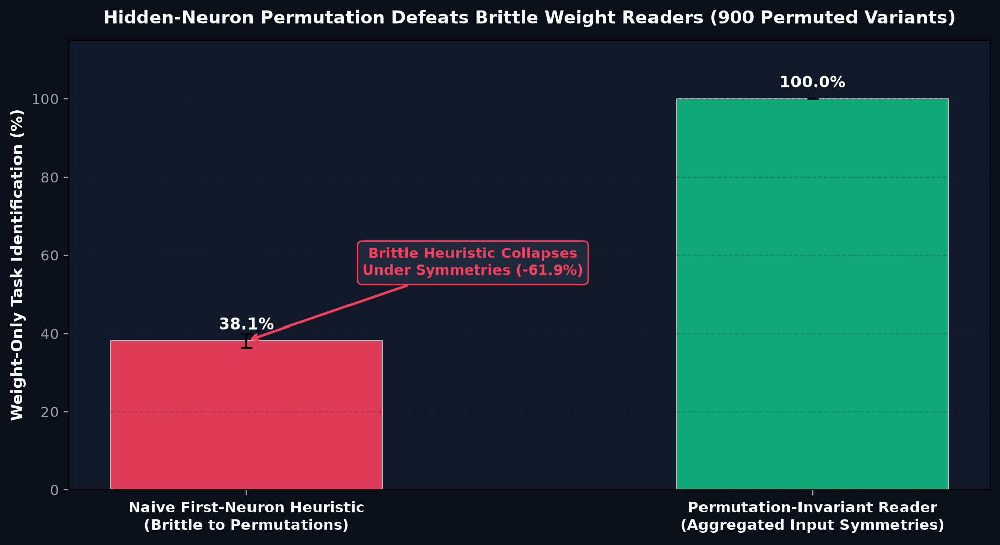
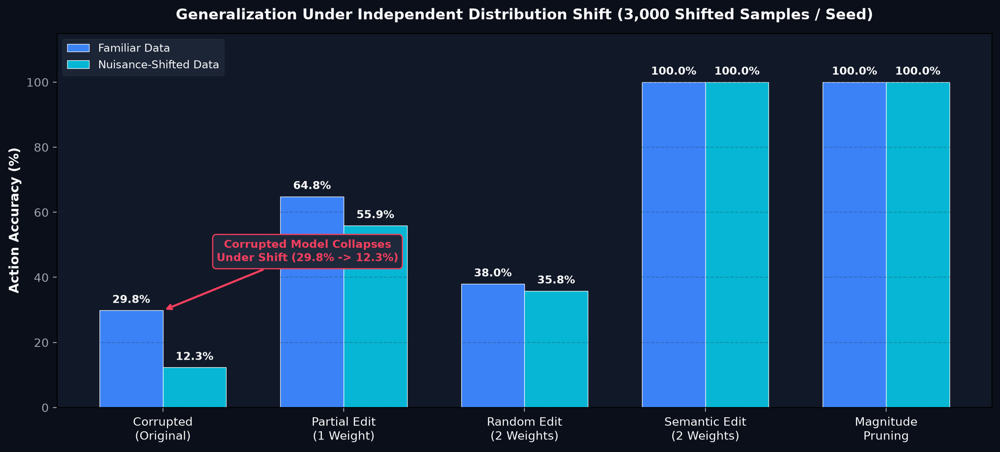
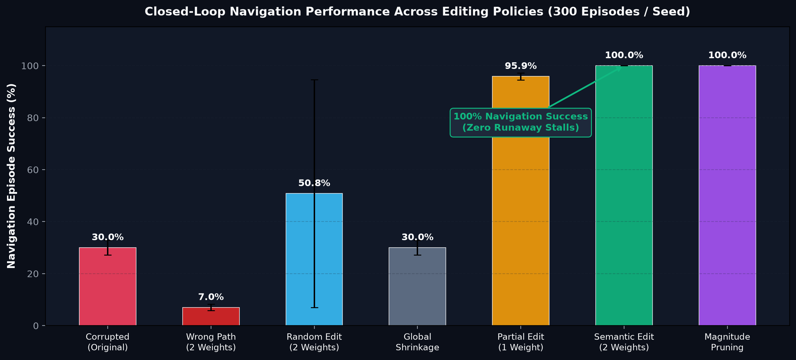

# Weight-Space Programming: A Controlled PyTorch Laboratory

<div align="center">

[](https://www.python.org/)
[](https://pytorch.org/)
[]()
[]()
[]()
[](ARTICLE.md)
[](LICENSE)

*A reproducible, offline PyTorch laboratory dissecting direct parameter inspection, weight-space symmetries, circuit compiling, sparse model repair without backpropagation, and essential non-LLM baselines.*

Inspired by MIT CSAIL's November 2026 report:  
**["Sparks of Weight-Space Programming"](https://rikiyat.github.io/blog/weight-space-programming/)** (Rikiya Takehi, Jayden Teoh, Alex Zhang, Omar Khattab).

</div>

---

## Executive Summary

When a neural network with nearly a billion parameters encounters a complex mathematical reasoning problem, it frequently fails not because it lacks underlying mathematical competence, but because its generation dynamics collapse into **infinite, repetitive reasoning loops**. The model exhausts its context window and stops before outputting an answer.

In November 2026, researchers from MIT CSAIL reported an extraordinary intervention: a language model (GPT-6 Astra) directly inspected the raw weights of **Qwen3.5-0.8B**, identified the pathological circuit responsible for the runaway generation loop, and surgically modified **0.016% of the weights (131,072 parameters)** across two weight matrices. Without fine-tuning, backpropagation, training datasets, or optimizer states, Qwen's MATH-500 accuracy surged from **7.9% to 48.1%** and GSM8K from **13.8% to 67.1%**.

This headline sounds like an AI learning how to reprogram another AI's brain. But it introduces a fundamental scientific and engineering question:

**Did the weight edit teach the model new mathematical capabilities, or did it merely repair an execution pathology that prevented an existing capability from terminating?**

This repository provides an **offline, zero-dependency, mathematically rigorous PyTorch laboratory** to study weight-space programming from first principles:
1. **Direct Circuit Compilation**: Compiling an exact 2-layer ReLU XOR network into 6 weights with zero gradient steps.
2. **Weight-Space Permutation Symmetries**: Proving why naive weight-reading heuristics fail when hidden neurons are permuted, and how permutation-invariant aggregation resolves the symmetry.
3. **Surgical Gradient-Free Repair**: Repairing a corrupted navigation policy by editing 2 of 131 weights (1.5%) to restore 100% held-out accuracy and zero runaway stalls.
4. **The Negative Control Dilemma**: Proving that simple **magnitude pruning** matches the semantic edit at 100% accuracy, demonstrating that complex LLM reasoning is not always necessary to resolve sparse weight corruptions.

---

## Rigorous Scope: What This Lab Does, Does Not, and Does Not Claim

To maintain strict scientific and pedagogical integrity:

### What This Lab DOES
- **Builds Inspectable PyTorch Circuits:** Constructs deterministic neural networks, exact hidden-unit permutations, and positive ReLU rescalings.
- **Audits Symmetries & Invariance:** Tests a naive first-neuron heuristic versus a permutation-invariant weight-reader across 900 permuted weight-space variants.
- **Benchmarks 6 Editing Policies:** Compares Corrupted Baseline, Semantic 2-Weight Repair, Top-Magnitude Pruning, Partial 1-Weight Edit, Random 2-Weight Edit, Global Output Shrinkage, and Wrong-Pathway Edit across 3,000 familiar and 3,000 shifted test samples per seed.
- **Measures Closed-Loop Rollouts:** Evaluates real agent episode success across 300 sequential navigation rollouts per seed.
- **Includes Algebraic Projection & Audit Tools:** Implements low-rank output-space projection (`projection.py`) and a standalone `.safetensors` difference counter (`audit_safetensors.py`).

### What This Lab DOES NOT Do
- Does **NOT** execute GPT-6 Astra, Claude, or proprietary frontier models.
- Does **NOT** download Qwen3.5-0.8B checkpoint weights or evaluate MATH-500 / GSM8K.
- Does **NOT** run backpropagation, gradient descent, or reinforcement learning.
- Does **NOT** claim that real LLM weight spaces are as transparent or low-dimensional as our toy circuits.

### What This Lab Does NOT Claim
- Does **NOT** claim that an LLM can automatically discover these repairs on arbitrary black-box neural networks.
- Does **NOT** claim that editing 0.016% of weights can inject new knowledge or reasoning that the model never previously possessed.
- Crucially highlights that **simple magnitude pruning achieves identical 100% performance**, establishing that researchers must always benchmark against non-LLM baselines before declaring that a language model has mastered weight-space reasoning.

---

## Architecture: Weight-Space Inspection & Permutation Symmetries

How can an observer read or edit a neural network's function directly from its weight tensors?

<div align="center">
  
</div>

### The Challenge of Weight-Space Symmetries
A neural network's parameters are not uniquely readable. For any hidden layer with activation function $\sigma$ (such as ReLU):
1. **Permutation Symmetry:** Permuting hidden neurons by a permutation matrix $P$ preserves the input-output function exactly:
   $$W_1' = P W_1, \quad b_1' = P b_1, \quad W_2' = W_2 P^T$$
2. **Positive Scaling Equivariance:** For ReLU networks, scaling neuron $j$ by $\alpha > 0$ in layer 1 and dividing by $\alpha$ in layer 2 leaves the network's output unchanged:
   $$\sigma(\alpha z) = \alpha \sigma(z) \quad (\text{for } \alpha > 0)$$

A naive weight reader that inspects the *first hidden neuron* collapses under permutation symmetries. As demonstrated below, permutation-invariant aggregation is required to read task coordinates reliably from raw weights.

---

## Key Experimental Findings (5 Seeds $\times$ 3,000 Samples = 15,000 Trials)

### 1. Sparse Weight Repair vs Statistical Controls
Can surgical weight editing without backpropagation restore a corrupted model?

<div align="center">
  
</div>

| Editing Policy | Changed Weights | Fraction Changed | Held-Out Familiar Acc | Shifted Nuisance Acc | Navigation Success |
| :--- | :---: | :---: | :---: | :---: | :---: |
| **Corrupted (Original)** | 0 / 131 | 0.0% | 29.8% $\pm$ 1.2% | 12.3% $\pm$ 0.6% | 30.0% $\pm$ 2.8% |
| **Semantic Repair** | **2 / 131** | **1.53%** | **100.0% $\pm$ 0.0%** | **100.0% $\pm$ 0.0%** | **100.0% $\pm$ 0.0%** |
| **Magnitude Pruning (Baseline)** | **2 / 131** | **1.53%** | **100.0% $\pm$ 0.0%** | **100.0% $\pm$ 0.0%** | **100.0% $\pm$ 0.0%** |
| **Partial Edit (1 Weight)** | 1 / 131 | 0.76% | 64.8% $\pm$ 1.0% | 55.9% $\pm$ 0.7% | 95.9% $\pm$ 1.4% |
| **Random 2-Weight Edit** | 2 / 131 | 1.53% | 38.0% $\pm$ 42.3% | 35.8% $\pm$ 42.0% | 50.8% $\pm$ 43.8% |
| **Global Output Shrinkage** | 4 / 131 | 3.05% | 29.8% $\pm$ 1.2% | 12.3% $\pm$ 0.6% | 30.0% $\pm$ 2.8% |
| **Wrong-Pathway Edit** | 2 / 131 | 1.53% | 0.0% $\pm$ 0.0% | 0.0% $\pm$ 0.0% | 7.0% $\pm$ 1.2% |

> [!IMPORTANT]
> **The Essential Negative Control:**
> The semantic repair zeroed out the two corrupted stall weights and restored 100% accuracy. However, **simple magnitude pruning achieved the exact same 100% recovery** without any semantic knowledge or language model assistance! This proves that research claiming "AI weight editing" must always test whether simple classical heuristics solve the exact same problem.

---

### 2. Permutation Symmetries Defeat Brittle Weight Readers
What happens when hidden neurons are re-ordered?

<div align="center">
  
</div>

- **Brittle First-Neuron Reader:** Achieves only **38.1% accuracy** across 900 permuted variants, failing whenever the target circuit is swapped into a different index.
- **Permutation-Invariant Reader:** Aggregates input connection signatures across all hidden units, achieving **100.0% accuracy** regardless of hidden neuron ordering.

---

### 3. Generalization Under Independent Distribution Shift
Does a weight-space patch survive unseen nuisance distribution shifts?

<div align="center">
  
</div>

- **Unpatched Model Collapses:** Under orthogonal nuisance noise, the unpatched model's accuracy plummets from **29.8% down to 12.3%** as stall loops dominate.
- **Surgical Repairs Remain Invariant:** Both the semantic repair and magnitude pruning maintain **100.0% accuracy** under distribution shift, confirming that the intervention excised the root cause rather than overfitting to familiar coordinates.

---

### 4. Closed-Loop Navigation Episodes
How does the repair translate to real sequential decision-making?

<div align="center">
  
</div>

- **Zero Runaway Stalls:** Across 300 closed-loop navigation episodes per seed, the repaired policy completed **100.0% of episodes in minimal steps (4.09 steps)**, completely eliminating the runaway stall failures of the corrupted model (which completed only 30.0% of episodes).

---

## Quick Start

Requires **Python 3.10+** and **PyTorch 2.0+**. Runs entirely on CPU without GPUs or external API keys.

```bash
# 1. Clone the repository and enter the lab
cd weight_space_programming_lab

# 2. Install dependencies
pip install -r requirements.txt

# 3. Run the 28-test verification suite
python -m unittest discover -s tests -v

# 4. Run the interactive demonstration (XOR compilation, permutations, and sparse repair)
python -m weightlab.demo

# 5. Run the full 5-seed benchmark
python -m weightlab.benchmark \
  --seeds 5 --readings 60 --samples 3000 --episodes 300 \
  --output results/benchmark.json
```

### Generate Publication-Quality Figures

To reproduce the charts shown in this documentation:

```bash
python plot_results.py
```
Generated PNGs are exported to [`figures/`](figures/).

---

## Optional: Audit Safetensors Checkpoints

The repository includes a standalone, dependency-free utility to inspect raw tensor differences between two `.safetensors` files without executing unsafe Python pickles:

```bash
pip install safetensors
python audit_safetensors.py model_base.safetensors model_edited.safetensors
```

---

## Repository Structure

```text
weight_space_programming_lab/
├── weightlab/                       # Core PyTorch simulation engine
│   ├── __init__.py
│   ├── core.py                      # Circuit builder, XOR compiler, permutations & invariant readers
│   ├── editing.py                   # 6 editing policies & tensor-by-tensor diff auditor
│   ├── evaluate.py                  # Seeded test samplers & closed-loop navigation rollout environment
│   ├── projection.py                # Standalone low-rank output direction suppression
│   ├── benchmark.py                 # Multi-seed experimental harness
│   └── demo.py                      # Interactive worked demonstration
├── figures/                         # High-resolution benchmark figures
│   ├── 01_weight_space_architecture.png
│   ├── 02_sparse_edit_heldout.png
│   ├── 03_weight_reading_symmetry.png
│   ├── 04_distribution_shift_robustness.png
│   └── 05_navigation_rollout_dynamics.png
├── results/                         # Benchmark results artifact
│   └── benchmark.json               # 5-seed benchmark summary and raw trial data
├── tests/
│   └── test_weightlab.py            # 28 hermetic unit tests
├── audit_safetensors.py             # Standalone safetensors diff inspection utility
├── ARTICLE.md                       # Comprehensive 31-section tutorial & case study
├── BENCHMARK_NOTES.md               # Methodological specifications & symmetry math
├── plot_results.py                  # Matplotlib script to recreate all figures
├── requirements.txt                 # Dependencies (torch, matplotlib, numpy)
├── LICENSE                          # MIT License
└── README.md
```

---

## Copyright, Trademarks & Legal Attribution

- **Original Research Attribution:** Inspired by MIT CSAIL's research report *Sparks of Weight-Space Programming* (November 2026) by Rikiya Takehi, Jayden Teoh, Alex Zhang, and Omar Khattab ([rikiyat.github.io/blog/weight-space-programming](https://rikiyat.github.io/blog/weight-space-programming/)).
- **Independent Educational Work:** This repository is an independent educational laboratory and Python/PyTorch implementation designed to explore weight-space symmetries and model editing mechanics. It contains no proprietary code or private weights from the original study.
- **Trademarks:** "Qwen", "Qwen3.5", "GPT-6", "Astra", and "MIT CSAIL" are trademarks or trade names of their respective owners. No official endorsement, sponsorship, or affiliation is implied or claimed.
- **Code License:** All original Python code in this lab is released under the [MIT License](LICENSE).

---

## License

MIT License. See [`LICENSE`](LICENSE) for full details.
