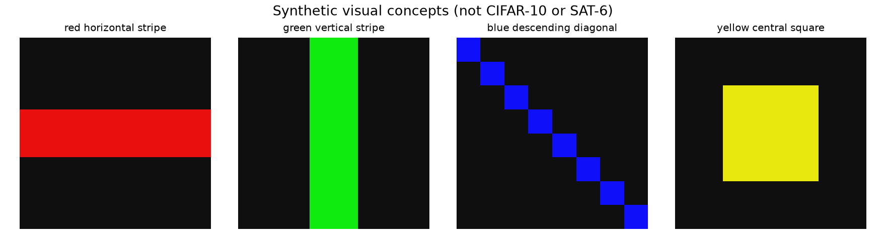
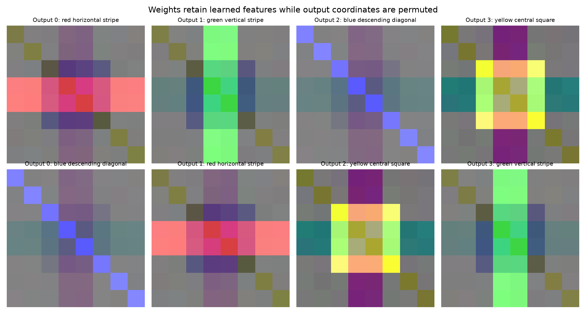
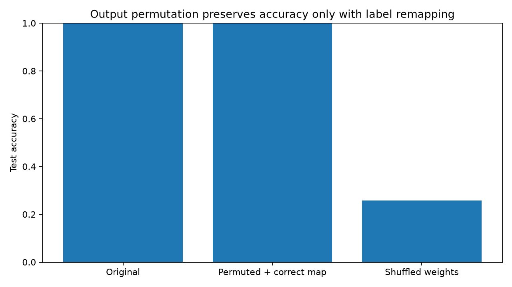

# Weight-Space Reading Audit Lab

[](https://www.python.org/downloads/)
[](https://numpy.org/)
[](https://matplotlib.org/)
[](tests/)
[](LICENSE)
[](src/)

A small, self-contained companion to the article **The AI Read the Weights Correctly. Then It Called a Satellite Classifier a Frog.**

This lab is **not** a reproduction of Ahmed (2026) or Takehi et al. (2026). It uses **synthetic 8×8 RGB images** and a **linear softmax classifier**, rather than real CIFAR-10/SAT-6 data and trained convolutional networks. It does **not** automatically call an LLM and does **not** establish any claim about a particular LLM's performance. It makes the *experimental logic* reproducible and cheap to test.

## Quickstart

```bash
python -m venv .venv
source .venv/bin/activate     # Windows: .venv\\Scripts\\activate
python -m pip install -r requirements.txt
PYTHONPATH=src python -m weight_audit.experiment --seed 7 --out results
PYTHONPATH=src python -m unittest discover -s tests -v
```

Run from the project root. No network access, datasets, or GPUs required.

## Five key interventions

1. Train a linear model on four obvious visual concepts (red horizontal stripe, green vertical stripe, blue diagonal, yellow center square).
2. **Output-label permutation**: reorder the final-layer columns and the output-to-class mapping together. With the correct label map, accuracy and class behavior are unchanged; an observer that assumes the original class order gets every name wrong.
3. **Shuffle-weight control**: scramble spatial weights inside each output, preserving each output's weight histogram while breaking the association to pixels.
4. **Hidden-unit permutation symmetry**: reorder ReLU hidden units and compensate in the outgoing matrix. The weight arrays change but the input-output function stays exactly identical.
5. **Exact forward-pass arithmetic**: inspect the tiny 2→3→2 ReLU exercise and test whether an LLM can calculate the full hidden states and final logits, rather than guessing the task from its architecture.

## Files

- `src/weight_audit/core.py`: synthetic data, linear classifier, training, permutation, shuffle, tiny MLP computation
- `src/weight_audit/experiment.py`: runs all interventions, exports metrics/weights, builds prompts and figures
- `prompts/`: copy/paste standalone blinded prompts for any model of your choice; outputs do not contain ground truth labels
- `results/metrics.json` and `.csv`: reproducible metrics
- `results/weight_filters.png`: before/after output-filter visualizations
- `results/accuracy_controls.png`: effect of interventions on test accuracy
- `results/synthetic_examples.png`: target visual concepts
- `results/hidden_unit_symmetry.json`: equivalent network with scrambled hidden neuron order
- `results/forward_pass_answer_key.json`: oracle solution (do not show to LLM before completion)
- `results/weights.npz`: weights and example tensors
- `tests/test_audit.py`: seven correctness tests
- `SOURCES.md`: primary source references and limits

## Visual Artifacts

### Target Visual Concepts & Synthetic Classes


### Output Weight Filters: Original vs Permuted vs Shuffled


### Accuracy Impact of Permutation & Shuffle Controls


## Exact permutation semantics

`order = [2, 0, 3, 1]` means **new output index -> old output index**. We create `W_new = W_old[:, order]`, `b_new = b_old[order]`, and `name_new[i] = name_old[order[i]]`. To compare accuracy, each original class label `old` becomes `new = inverse_order[old]`.

The identity to check is `logits_new(x) == logits_old(x)[:, order]`. This is coordinate reindexing, **not** an unchanged output vector. The model's *semantic classifications* remain identical after following the new class map.

## Copy/paste LLM audit procedure

Try prompts `01_original_blind.txt` and `02_permuted_blind.txt` in separate fresh chats of the **same** model at matching settings. Do not give the model the ground truth mapping. Compare predicted semantics and output indices against `results/metrics.json`. Try `03_shuffled_blind.txt` and `04_permuted_with_candidate_vocabulary.txt` as controls. Keep full transcripts and log model version, date, tool access, seed and sampling settings.

Score **observations from numbers** separately from **semantic output-label guesses**. An answer with exact algebra but incorrect class names does not show full functional understanding. Repeat over several seeds and new class orders for statistical reliability.

To test hidden-unit nonidentifiability, inspect `06_hidden_unit_symmetry.txt`. For an even more direct test, use `05_exact_forward_pass.txt` with tools disabled and compare against `results/forward_pass_answer_key.json`. This task is deliberately tiny and is not a substitute for verifying full CNN feature tracing.

## Important limitations

- In the synthetic linear classifier, weights directly reveal class templates. Real CNNs have nonlinear intermediate layers, so reading semantics is much harder.
- The model's class labels cannot be *uniquely deduced* from a set of unlabeled output coordinates without external semantic anchors, a labeled reference or inputs sufficient to interpret the channels. The candidate vocabulary intervention makes one such anchor explicit.
- Matching or failing an output permutation test is evidence about behavior, not direct access to an LLM's internal reasoning mechanism.
- Shuffling destroys the weights, so accuracy normally drops. It is a **negative control**, not a functioning model with intentionally changed labels.
- A successful edit or good benchmark score does not itself prove a model understood the causal mechanism of the weight update.

## Suggested extensions

Train multiple seeds and vary all 24 possible output permutations; replace synthetic RGB classes with dataset classes the LLM cannot have memorized; run a *CNN* with 2–3 layers and attempt exact forward-pass tracing; add evaluator-blind human labels; include no-tool and tool-enabled conditions separately.
